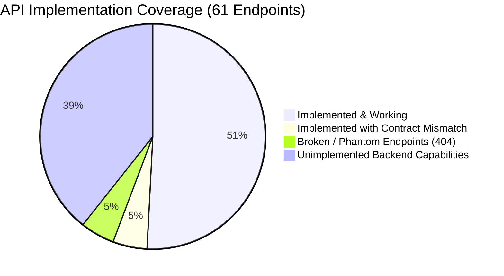
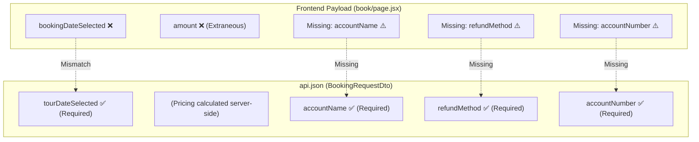
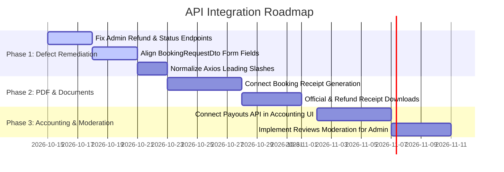

# TravelKo — API Audit & Implementation Documentation

**Document Version:** 1.0.0  
**Audit Date:** October 2026  
**Audited Specification:** `api/api.json` (OpenAPI 3.0.0, 61 Operations, 54 Paths)  
**Implementation Target:** `travelko-next` (Next.js 16 App Router Frontend)  
**API Gateway Base URL:** `https://api.travelko.site/` (Default)  

---

## 1. Executive Summary

This documentation presents a comprehensive audit comparing the OpenAPI 3.0 specification ([`api/api.json`](file:///C:/Users/feljo/Desktop/TravelKo/api/api.json)) against the implemented API consumption layer in the TravelKo frontend codebase ([`travelko-next`](file:///C:/Users/feljo/Desktop/TravelKo/travelko-next)).

The audit evaluated **61 API operations** across **11 system modules**, verifying endpoint existence, HTTP method adherence, request payload schema compliance, parameter consistency, authentication/authorization handling, and UI integration status.

### Audit Scorecard



| Metric | Count | Percentage | Status |
|---|---|---|---|
| **Total Spec Endpoints** | **61** | 100% | Full OpenAPI 3.0 catalog |
| **Active / Consumed in Frontend** | **34** | 55.7% | Operational or partially operational |
| ↳ *Working & Schema-Compliant* | 31 | 50.8% | Matches OpenAPI contract |
| ↳ *Payload / Contract Mismatches* | 3 | 4.9% | Requires payload / field alignment |
| **Broken / Phantom Endpoint Calls** | **3** | — | Calls endpoints nonexistent in `api.json` (Produces 404s) |
| **Unimplemented / Dormant in UI** | **27** | 44.3% | Backend endpoints not hooked to any UI view |
| **Mocked / Hardcoded Views** | **2** | — | Accounting dashboard & legacy bookings view |

---

## 2. Critical Findings & Defect Log

### 🔴 DEFECT-01: Phantom Booking Status Endpoints (Induces 404 Errors)
* **Severity:** Critical  
* **Affected File:** [`src/app/(admin)/admin/booking-applications/page.jsx`](file:///C:/Users/feljo/Desktop/TravelKo/travelko-next/src/app/(admin)/admin/booking-applications/page.jsx#L122-L215)  
* **Description:** The Admin Booking Applications management table has action buttons for approving, marking paid, and refunding bookings. However, three of these actions make HTTP requests to endpoints that **do not exist** anywhere in `api.json`.

| Action in Admin UI | Code Call (Current) | Status in `api.json` | Actual Spec Alternative |
|---|---|---|---|
| Mark Private Booking as Paid / Approved | `PUT /booking/private/update-status/${id}` | ❌ **Nonexistent** (Returns 404) | `PUT /booking/private/approve/{bookingId}` or `PATCH /dev/bookings/{bookingId}/status` |
| Mark All Joiners as Paid | `PATCH /booking/joiner/update-status-to-paid/${tourId}` | ❌ **Nonexistent** (Returns 404) | No bulk update endpoint in spec. Status is set via gateway webhook or individual booking records. |
| Process Client Refund | `PATCH booking/update-status/${bookingId}` | ❌ **Nonexistent** (Returns 404, missing leading slash) | `PATCH /booking/update-status-to-refunded/{bookingId}` |

> [!CAUTION]
> Clicking "Process client refund" fails in production because the developer wrote `booking/update-status/${bookingId}` instead of `/booking/update-status-to-refunded/${bookingId}`.

---

### 🔴 DEFECT-02: Public Booking Contract Drift (`BookingRequestDto`)
* **Severity:** High  
* **Affected Files:**  
  * [`src/app/(public)/book/page.jsx`](file:///C:/Users/feljo/Desktop/TravelKo/travelko-next/src/app/(public)/book/page.jsx#L175-L191)  
  * [`src/app/(public)/tours/book-private/page.jsx`](file:///C:/Users/feljo/Desktop/TravelKo/travelko-next/src/app/(public)/tours/book-private/page.jsx#L110-L123)  
* **Target Endpoint:** `POST /booking/{tourId}`  
* **Problem:**  
  The NestJS backend enforces `BookingRequestDto`. The frontend deviates significantly from the schema:
  1. **Field Name Mismatch:** The frontend submits `bookingDateSelected: [...]`, but `api.json` expects **`tourDateSelected: [...]`** (array of string).
  2. **Missing Required Fields:** `BookingRequestDto` marks `accountName`, `refundMethod`, and `accountNumber` as **required** (used for automated client refund routing). The frontend booking forms never collect or submit these 3 fields!
  3. **Extraneous Field:** The frontend submits `amount: String(...)`, which is ignored or rejected by strict validation pipes (`whitelist: true, forbidNonWhitelisted: true`).



---

### 🟡 DEFECT-03: Coordinator Registration Content-Type Mismatch
* **Severity:** Medium  
* **Affected File:** [`src/app/(public)/coordinator/register-with-profile/page.jsx`](file:///C:/Users/feljo/Desktop/TravelKo/travelko-next/src/app/(public)/coordinator/register-with-profile/page.jsx#L390-L405)  
* **Target Endpoint:** `POST /auth/coordinator`  
* **Problem:**  
  * In `api.json`, `POST /auth/coordinator` accepts **`application/json`** using `CreateCoordinatorDto` (`username`, `password`, `fullName`, `phoneNumber`, `email`, `gender`).
  * While [`coordinator/register/page.jsx`](file:///C:/Users/feljo/Desktop/TravelKo/travelko-next/src/app/(public)/coordinator/register/page.jsx#L58) sends standard JSON, [`coordinator/register-with-profile/page.jsx`](file:///C:/Users/feljo/Desktop/TravelKo/travelko-next/src/app/(public)/coordinator/register-with-profile/page.jsx#L404) attempts to submit a `FormData` object containing `profilePicture` and `idPictures`.
  * If the backend route handler does not have a `FileFieldsInterceptor` attached, multipart file uploads sent to `POST /auth/coordinator` will either crash NestJS's body parser or drop the files entirely. The official endpoint designed for multipart uploads with profile/ID images is **`PUT /auth/coordinator`**.

---

### 🟡 DEFECT-04: API Gateway Base URL Divergence
* **Severity:** Medium  
* **Affected Files:**  
  * [`src/services/api.js`](file:///C:/Users/feljo/Desktop/TravelKo/travelko-next/src/services/api.js#L5): `process.env.NEXT_PUBLIC_API_BASE_URL || "https://api.travelko.site/"`  
  * [`src/app/(public)/map/page.jsx`](file:///C:/Users/feljo/Desktop/TravelKo/travelko-next/src/app/(public)/map/page.jsx#L12): `process.env.NEXT_PUBLIC_API_BASE_URL || "https://api.travelkoph.com/"`  
* **Problem:**  
  `map/page.jsx` contains a hardcoded fallback to `api.travelkoph.com`, whereas all other services and pages fallback to `api.travelko.site`. If the environment variable is not defined on deployment, the map explorer queries a different domain.

---

### 🟡 DEFECT-05: Leading Slash Inconsistency in Axios Calls
* **Severity:** Low  
* **Description:** Throughout the frontend, endpoints are called inconsistently with and without leading slashes:
  * With slash: `api.get("/booking/private/find-all")`, `api.get("/auth/admin/dashboard")`
  * Without slash: `api.get("tours/my-tours")`, `api.get("location/suggestions")`, `api.post("booking/${tourId}")`
* In Axios, when `baseURL` has a trailing slash (`https://api.travelko.site/`), resolving a relative URL without a leading slash works identically to one with a leading slash, but any change to `baseURL` (e.g. omitting the trailing slash) will cause malformed URLs (e.g. `https://api.travelko.sitetours/my-tours`).

---

## 3. Module-by-Module Audit Catalog

Below is the comprehensive audit of all 61 endpoints defined in [`api/api.json`](file:///C:/Users/feljo/Desktop/TravelKo/api/api.json), organized by module tag.

### 3.1. Authentication Module (`Auth`)
The Auth module handles coordinator registration, profile management, password recovery, coordinator onboarding approval, and administrative dashboards.

| Method | Endpoint | Operation ID | Auth | Implementation Status | Call Site in Frontend | Notes & Contract Validation |
|---|---|---|---|---|---|---|
| `POST` | `/auth/coordinator` | `AuthController_createCoordinator` | No | 🟢 **Implemented** | [`register/page.jsx:58`](file:///C:/Users/feljo/Desktop/TravelKo/travelko-next/src/app/(public)/coordinator/register/page.jsx#L58), [`register-with-profile/page.jsx:404`](file:///C:/Users/feljo/Desktop/TravelKo/travelko-next/src/app/(public)/coordinator/register-with-profile/page.jsx#L404) | Simple register sends JSON (`CreateCoordinatorDto`). Multi-step register sends FormData (see Defect-03). |
| `GET` | `/auth/coordinator` | `AuthController_getCoordinator` | Bearer | 🟢 **Implemented** | [`coordinator/profile/page.jsx:38`](file:///C:/Users/feljo/Desktop/TravelKo/travelko-next/src/app/(coordinator)/coordinator/profile/page.jsx#L38) | Returns coordinator profile object with image URLs & bank details. |
| `PUT` | `/auth/coordinator` | `AuthController_updateCoordinator` | Bearer | 🟢 **Implemented** | [`coordinator/profile/page.jsx:127`](file:///C:/Users/feljo/Desktop/TravelKo/travelko-next/src/app/(coordinator)/coordinator/profile/page.jsx#L127) | Successfully sends `multipart/form-data` with optional `profilePicture` and `idPictures`. |
| `POST` | `/auth/coordinator/login` | `AuthController_coordinatorLogin` | No | 🟢 **Implemented** | [`login/page.jsx:46`](file:///C:/Users/feljo/Desktop/TravelKo/travelko-next/src/app/(public)/login/page.jsx#L46) | Dynamic dispatch based on selected role (`coordinator`). |
| `POST` | `/auth/admin/login` | `AuthController_adminLogin` | No | 🟢 **Implemented** | [`login/page.jsx:46`](file:///C:/Users/feljo/Desktop/TravelKo/travelko-next/src/app/(public)/login/page.jsx#L46) | Dynamic dispatch based on selected role (`admin`). |
| `POST` | `/auth/coordinator/forgot-password` | `AuthController_forgotPassword` | No | 🟢 **Implemented** | [`forgot-password/page.jsx:30`](file:///C:/Users/feljo/Desktop/TravelKo/travelko-next/src/app/(public)/forgot-password/page.jsx#L30) | Submits `{ email }` payload. |
| `POST` | `/auth/coordinator/reset-password/{token}` | `AuthController_resetPassword` | No | 🟢 **Implemented** | [`reset-password/[token]/page.jsx:52`](file:///C:/Users/feljo/Desktop/TravelKo/travelko-next/src/app/(public)/coordinator/reset-password/[token]/page.jsx#L52) | Sends `{ newPassword }`. |
| `GET` | `/auth/test/guard` | `AuthController_testGuard` | Bearer | ⚪ **Unimplemented** | None | Development/testing token validation route. |
| `GET` | `/auth/coordinator/stats` | `AuthController_getCoordinatorStats` | Bearer | 🟢 **Implemented** | [`coordinator/dashboard/page.jsx:29`](file:///C:/Users/feljo/Desktop/TravelKo/travelko-next/src/app/(coordinator)/coordinator/dashboard/page.jsx#L29) | Fetches coordinator KPI cards (bookings, revenue, rating). |
| `GET` | `/auth/admin/approved-coordinators` | `AuthController_getApprovedCoordinators` | Bearer | 🟢 **Implemented** | [`admin/coordinators/page.jsx:24`](file:///C:/Users/feljo/Desktop/TravelKo/travelko-next/src/app/(admin)/admin/coordinators/page.jsx#L24), [`admin/coordinator/[id]/page.jsx:31`](file:///C:/Users/feljo/Desktop/TravelKo/travelko-next/src/app/(admin)/admin/coordinator/[id]/page.jsx#L31) | Fetches approved coordinator list. |
| `DELETE` | `/auth/admin/delete-coordinator/{id}` | `AuthController_deleteCoordinator` | Bearer | 🟢 **Implemented** | [`admin/coordinator/[id]/page.jsx:67`](file:///C:/Users/feljo/Desktop/TravelKo/travelko-next/src/app/(admin)/admin/coordinator/[id]/page.jsx#L67) | Deletes coordinator account. |
| `GET` | `/auth/admin/for-approval-coordinators` | `AuthController_getForApprovalCoordinators` | Bearer | 🟢 **Implemented** | [`admin/applications/page.jsx:21`](file:///C:/Users/feljo/Desktop/TravelKo/travelko-next/src/app/(admin)/admin/applications/page.jsx#L21) | Lists pending coordinator applications. |
| `PATCH` | `/auth/admin/approve-coordinator/{id}` | `AuthController_approveCoordinator` | Bearer | 🟢 **Implemented** | [`admin/applications/page.jsx:43`](file:///C:/Users/feljo/Desktop/TravelKo/travelko-next/src/app/(admin)/admin/applications/page.jsx#L43) | Approves pending coordinator. |
| `GET` | `/auth/admin/decline-coordinator/{id}` | `AuthController_declineCoordinator` | Bearer | 🟢 **Implemented** | [`admin/applications/page.jsx:65`](file:///C:/Users/feljo/Desktop/TravelKo/travelko-next/src/app/(admin)/admin/applications/page.jsx#L65) | Rejects application. Note: OpenAPI spec defines `GET` for this mutation. |
| `GET` | `/auth/admin/tours-created-by-coordinator/{coordinatorId}` | `AuthController_getToursCreatedByCoordinator` | Bearer | 🟢 **Implemented** | [`admin/coordinator/[id]/page.jsx:36`](file:///C:/Users/feljo/Desktop/TravelKo/travelko-next/src/app/(admin)/admin/coordinator/[id]/page.jsx#L36), [`admin/coordinators/page.jsx:31`](file:///C:/Users/feljo/Desktop/TravelKo/travelko-next/src/app/(admin)/admin/coordinators/page.jsx#L31) | Fetches tour packages authored by a coordinator. |
| `GET` | `/auth/admin/dashboard` | `AuthController_getAdminDashboard` | Bearer | 🟢 **Implemented** | [`admin/dashboard/page.jsx:29`](file:///C:/Users/feljo/Desktop/TravelKo/travelko-next/src/app/(admin)/admin/dashboard/page.jsx#L29) | Fetches admin global stats & analytics. |

---

### 3.2. Tours Module (`Tours`)
Handles creation, listing, geographic discovery, updating, and cancellation workflows for tour packages.

| Method | Endpoint | Operation ID | Auth | Implementation Status | Call Site in Frontend | Notes & Contract Validation |
|---|---|---|---|---|---|---|
| `POST` | `/tours/create` | `ToursController_create` | Bearer | 🟢 **Implemented** | [`coordinator/tours/page.jsx:389`](file:///C:/Users/feljo/Desktop/TravelKo/travelko-next/src/app/(coordinator)/coordinator/tours/page.jsx#L389) | Uses `multipart/form-data`. Array fields correctly JSON stringified. |
| `GET` | `/tours` | `ToursController_findAll` | No | 🟢 **Implemented** | [`page.js:49`](file:///C:/Users/feljo/Desktop/TravelKo/travelko-next/src/app/(public)/page.js#L49), [`map/page.jsx:11`](file:///C:/Users/feljo/Desktop/TravelKo/travelko-next/src/app/(public)/map/page.jsx#L11), [`tours/page.jsx:6`](file:///C:/Users/feljo/Desktop/TravelKo/travelko-next/src/app/(public)/tours/page.jsx#L6), [`book/page.jsx:90`](file:///C:/Users/feljo/Desktop/TravelKo/travelko-next/src/app/(public)/book/page.jsx#L90) | Public tour list. Used in landing, map, search, and booking screens. |
| `GET` | `/tours/my-tours` | `ToursController_findMyTours` | Bearer | 🟢 **Implemented** | [`coordinator/tours/page.jsx:199`](file:///C:/Users/feljo/Desktop/TravelKo/travelko-next/src/app/(coordinator)/coordinator/tours/page.jsx#L199) | Loads coordinator-owned tour packages. |
| `GET` | `/tours/{id}` | `ToursController_findOne` | No | 🟢 **Implemented** | [`tours/details/[id]/page.jsx:9`](file:///C:/Users/feljo/Desktop/TravelKo/travelko-next/src/app/(public)/tours/details/[id]/page.jsx#L9), [`TourDetailsClient.jsx:91`](file:///C:/Users/feljo/Desktop/TravelKo/travelko-next/src/components/TourDetailsClient.jsx#L91), [`coordinator/bookings/page.jsx:204`](file:///C:/Users/feljo/Desktop/TravelKo/travelko-next/src/app/(coordinator)/coordinator/bookings/page.jsx#L204) | Full tour details with nested reviews. |
| `DELETE` | `/tours/{id}` | `ToursController_delete` | Bearer | 🟢 **Implemented** | [`coordinator/tours/page.jsx:432`](file:///C:/Users/feljo/Desktop/TravelKo/travelko-next/src/app/(coordinator)/coordinator/tours/page.jsx#L432) | Deletes a tour package. |
| `PUT` | `/tours/update/{id}` | `ToursController_update` | Bearer | 🟢 **Implemented** | [`coordinator/tours/page.jsx:381`](file:///C:/Users/feljo/Desktop/TravelKo/travelko-next/src/app/(coordinator)/coordinator/tours/page.jsx#L381) | Updates tour package with multipart data. |
| `GET` | `/tours/generate_cancellation_link/{tourId}/{bookerId}` | `ToursController_generateCancellationLink` | No | ⚪ **Unimplemented** | None | Backend endpoint to generate email cancellation magic link. |
| `GET` | `/tours/all/statuses` | `ToursController_getAllTourStatuses` | Bearer | 🟢 **Implemented** | [`coordinator/bookings/page.jsx:55`](file:///C:/Users/feljo/Desktop/TravelKo/travelko-next/src/app/(coordinator)/coordinator/bookings/page.jsx#L55) | Fetches tour status options (`draft`, `upcoming`, `ongoing`, `completed`). |

---

### 3.3. Bookings Module (`Bookings`)
The core transactional module handling traveler booking submissions, status workflows, approvals, rejections, and cancellations.

| Method | Endpoint | Operation ID | Auth | Implementation Status | Call Site in Frontend | Notes & Contract Validation |
|---|---|---|---|---|---|---|
| `POST` | `/booking/{tourId}` | `BookingsController_create` | No | 🟡 **Contract Drift** | [`book/page.jsx:191`](file:///C:/Users/feljo/Desktop/TravelKo/travelko-next/src/app/(public)/book/page.jsx#L191), [`book-private/page.jsx:123`](file:///C:/Users/feljo/Desktop/TravelKo/travelko-next/src/app/(public)/tours/book-private/page.jsx#L123) | **High Risk:** Sends `bookingDateSelected` instead of `tourDateSelected`. Missing required fields `accountName`, `refundMethod`, `accountNumber`. |
| `GET` | `/booking/cancel-booking` | `BookingsController_cancelBookingViaLink` | No | ⚪ **Unimplemented** | None | Receives `token` query param. Intended for booker email cancellation link. |
| `GET` | `/booking/tours/joiners` | `BookingsController_getToursWithJoinerBookings` | Bearer | 🟢 **Implemented** | [`coordinator/bookings/page.jsx:112`](file:///C:/Users/feljo/Desktop/TravelKo/travelko-next/src/app/(coordinator)/coordinator/bookings/page.jsx#L112) | Loads coordinator tours with joiner bookings. |
| `GET` | `/booking/tours/private` | `BookingsController_getToursWithPrivateBookings` | Bearer | 🟢 **Implemented** | [`coordinator/bookings/page.jsx:112`](file:///C:/Users/feljo/Desktop/TravelKo/travelko-next/src/app/(coordinator)/coordinator/bookings/page.jsx#L112) | Loads private booking requests for coordinator. |
| `GET` | `/booking/joiners/{tourId}` | `BookingsController_getActiveJoinersByTourId` | Bearer | ⚪ **Unimplemented** | None | Coordinator currently displays joiners from nested `tour.bookings`. |
| `PATCH` | `/booking/cancel/{tourId}/joiners` | `BookingsController_cancelJoinerBookings` | Bearer | 🟢 **Implemented** | [`coordinator/bookings/page.jsx:319`](file:///C:/Users/feljo/Desktop/TravelKo/travelko-next/src/app/(coordinator)/coordinator/bookings/page.jsx#L319) | Cancels all joiners for a tour package. |
| `PUT` | `/booking/private/approve/{bookingId}` | `BookingsController_approvePrivateBooking` | Bearer | 🟢 **Implemented** | [`coordinator/bookings/page.jsx:221`](file:///C:/Users/feljo/Desktop/TravelKo/travelko-next/src/app/(coordinator)/coordinator/bookings/page.jsx#L221) | Sends `{ price, remarks }` (`ApproveBookingDto`). |
| `PUT` | `/booking/private/reject/{bookingId}` | `BookingsController_rejectPrivateBooking` | Bearer | 🟢 **Implemented** | [`coordinator/bookings/page.jsx:261`](file:///C:/Users/feljo/Desktop/TravelKo/travelko-next/src/app/(coordinator)/coordinator/bookings/page.jsx#L261) | Sends `{ remarks }` (`RejectBookingDto`). |
| `PUT` | `/booking/cancel/{bookingId}/private` | `BookingsController_cancelPrivateBooking` | Bearer | 🟢 **Implemented** | [`coordinator/bookings/page.jsx:292`](file:///C:/Users/feljo/Desktop/TravelKo/travelko-next/src/app/(coordinator)/coordinator/bookings/page.jsx#L292) | Sends `{ remarks }` (`CancelPrivateBookingDto`). |
| `GET` | `/booking/joiner/find-all` | `BookingsController_findAllJoinerBookings` | Bearer | 🟢 **Implemented** | [`admin/booking-applications/page.jsx:92`](file:///C:/Users/feljo/Desktop/TravelKo/travelko-next/src/app/(admin)/admin/booking-applications/page.jsx#L92) | Admin joiner bookings table. |
| `GET` | `/booking/private/find-all` | `BookingsController_findAllPrivateBookings` | Bearer | 🟢 **Implemented** | [`admin/booking-applications/page.jsx:76`](file:///C:/Users/feljo/Desktop/TravelKo/travelko-next/src/app/(admin)/admin/booking-applications/page.jsx#L76) | Admin private bookings table. |
| `PATCH` | `/booking/update-status-to-refunded/{bookingId}` | `BookingsController_updateStatusToRefunded` | Bearer | 🔴 **Broken in UI** | [`admin/booking-applications/page.jsx:202`](file:///C:/Users/feljo/Desktop/TravelKo/travelko-next/src/app/(admin)/admin/booking-applications/page.jsx#L202) | Frontend calls `booking/update-status/${bookingId}` instead of `/booking/update-status-to-refunded/${bookingId}`. Fails with 404. |
| `GET` | `/booking/all/statuses` | `BookingsController_getAllBookingStatuses` | Bearer | 🟢 **Implemented** | [`coordinator/bookings/page.jsx:53`](file:///C:/Users/feljo/Desktop/TravelKo/travelko-next/src/app/(coordinator)/coordinator/bookings/page.jsx#L53) | Fetches booking status options (`request`, `approved`, `cancelled`, `rejected`, `refunded`, etc.). |

---

### 3.4. Bookers Module (`Bookers`)
Provides standalone CRUD operations for booker customer profiles.

| Method | Endpoint | Operation ID | Auth | Implementation Status | Call Site in Frontend | Notes & Contract Validation |
|---|---|---|---|---|---|---|
| `POST` | `/bookers` | `BookersController_create` | Bearer | ⚪ **Unimplemented** | None | Standalone booker creation. Bookers are created implicitly during `POST /booking/{tourId}`. |
| `GET` | `/bookers` | `BookersController_findAll` | Bearer | ⚪ **Unimplemented** | None | No customer directory view exists in Admin panel. |
| `PATCH` | `/bookers/{id}` | `BookersController_update` | Bearer | ⚪ **Unimplemented** | None | Customer profile update not exposed. |
| `DELETE` | `/bookers/{id}` | `BookersController_remove` | Bearer | ⚪ **Unimplemented** | None | Customer deletion not exposed. |

---

### 3.5. Payment Module (`Payment`)
Integrates payment gateway operations (e.g., PayMongo/Xendit/GCash) and webhook listeners.

| Method | Endpoint | Operation ID | Auth | Implementation Status | Call Site in Frontend | Notes & Contract Validation |
|---|---|---|---|---|---|---|
| `POST` | `/payment` | `PaymentController_create` | Bearer | ⚪ **Unimplemented** | None | Payment intent / checkout session creation. Frontend relies on URL returned by `POST /booking/{tourId}`. |
| `GET` | `/payment/{id}` | `PaymentController_findOne` | Bearer | ⚪ **Unimplemented** | None | Query payment transaction details. |
| `POST` | `/payment/cancel/{id}` | `PaymentController_cancelPayment` | Bearer | ⚪ **Unimplemented** | None | Void/cancel payment transaction. |
| `POST` | `/payment/methods` | `PaymentController_getPaymentMethods` | Bearer | ⚪ **Unimplemented** | None | Query available payment channels dynamically. |
| `POST` | `/payment/webhook` | `PaymentController_webhook` | No | ⚪ **Server-to-Server** | N/A | Payment gateway webhook handler. Not intended for frontend invocation. |

---

### 3.6. Documents Module (`Documents`)
Handles server-side rendering of official transaction PDFs and receipts.

| Method | Endpoint | Operation ID | Auth | Implementation Status | Call Site in Frontend | Notes & Contract Validation |
|---|---|---|---|---|---|---|
| `POST` | `/documents/pdf/booking-receipt` | `DocumentsController_generateBookingReceipt` | Bearer | ⚪ **Unimplemented** | None | Receipt PDF download for traveler booking confirmation. |
| `POST` | `/documents/pdf/official-receipt` | `DocumentsController_generateOfficialReceipt` | Bearer | ⚪ **Unimplemented** | None | Official BIR-compliant electronic receipt. |
| `POST` | `/documents/pdf/acknowledgement-receipt` | `DocumentsController_generateAcknowledgementReceipt` | Bearer | ⚪ **Unimplemented** | None | Payment acknowledgement receipt. |
| `POST` | `/documents/pdf/refund-receipt` | `DocumentsController_generateRefundReceipt` | Bearer | ⚪ **Unimplemented** | None | Proof of refund receipt. |
| `POST` | `/documents/pdf/create` | `DocumentsController_createPdf` | Bearer | ⚪ **Unimplemented** | None | General PDF document generator. |

---

### 3.7. Reviews Module (`Reviews`)
Manages traveler ratings, testimonials, and review moderation.

| Method | Endpoint | Operation ID | Auth | Implementation Status | Call Site in Frontend | Notes & Contract Validation |
|---|---|---|---|---|---|---|
| `POST` | `/reviews/{tourId}` | `ReviewsController_createReview` | No | 🟢 **Implemented** | [`TourDetailsClient.jsx:84`](file:///C:/Users/feljo/Desktop/TravelKo/travelko-next/src/components/TourDetailsClient.jsx#L84) | Submits `{ content, rating, fullName }` (`CreateReviewDto`). |
| `GET` | `/reviews` | `ReviewsController_findAll` | No | ⚪ **Unimplemented** | None | Global reviews listing. (Individual tour reviews are retrieved via `GET /tours/{id}`). |
| `GET` | `/reviews/{id}` | `ReviewsController_findOne` | No | ⚪ **Unimplemented** | None | Single review detail. |
| `PATCH` | `/reviews/{id}` | `ReviewsController_update` | Bearer | ⚪ **Unimplemented** | None | Review editing / admin moderation. |
| `DELETE` | `/reviews/{id}` | `ReviewsController_remove` | Bearer | ⚪ **Unimplemented** | None | Review deletion / moderation. |

---

### 3.8. Accounting Module (`Accounting`)
Manages financial records, service fees, and coordinator payout settlements.

| Method | Endpoint | Operation ID | Auth | Implementation Status | Call Site in Frontend | Notes & Contract Validation |
|---|---|---|---|---|---|---|
| `POST` | `/accounting/payout` | `AccountingController_createPayout` | Bearer | ⚪ **Unimplemented** | None | Submits `CreatePayoutDto` (`tourId`, `bookingIds`, `paymentMethod`, `referenceNo`, `paidAt`, `transactionFee`, `remarks`). The entire Accounting page ([`admin/accounting/page.jsx`](file:///C:/Users/feljo/Desktop/TravelKo/travelko-next/src/app/(admin)/admin/accounting/page.jsx)) currently runs on mock JSON data. |

---

### 3.9. Locations Module (`Locations`)
Provides Mapbox / Nominatim geospatial search and suggestions.

| Method | Endpoint | Operation ID | Auth | Implementation Status | Call Site in Frontend | Notes & Contract Validation |
|---|---|---|---|---|---|---|
| `GET` | `/location/suggestions` | `LocationsController_getSuggestions` | Bearer | 🟢 **Implemented** | [`coordinator/tours/page.jsx:292`](file:///C:/Users/feljo/Desktop/TravelKo/travelko-next/src/app/(coordinator)/coordinator/tours/page.jsx#L292) | Queries `place` search term for tour address autocomplete. |

---

### 3.10. Development & Diagnostic Module (`Development`, `App`)
Utility routes for seeding, automated QA, and service health.

| Method | Endpoint | Operation ID | Auth | Implementation Status | Call Site in Frontend | Notes & Contract Validation |
|---|---|---|---|---|---|---|
| `GET` | `/` | `AppController_getHello` | No | ⚪ **Unimplemented** | None | Basic health check / root welcome endpoint. |
| `PATCH` | `/dev/tours/{tourId}/status` | `DevelopmentController_updateTourStatus` | Bearer | ⚪ **Unimplemented** | None | Test helper to override tour status (`DevUpdateTourStatusDto`). |
| `PATCH` | `/dev/bookings/{bookingId}/status` | `DevelopmentController_updateBookingStatus` | Bearer | ⚪ **Unimplemented** | None | Test helper to override booking status (`DevUpdateBookingStatusDto`). |

---

## 4. Phantom & Mismatched Call Log

The following table summarizes all client-side calls in `travelko-next` that **do not match** `api/api.json`:

| File | Line | Called HTTP Request | Reason for Failure | Recommended Remedy |
|---|---|---|---|---|
| [`admin/booking-applications/page.jsx`](file:///C:/Users/feljo/Desktop/TravelKo/travelko-next/src/app/(admin)/admin/booking-applications/page.jsx#L125) | 125 | `PUT /booking/private/update-status/${id}` | Route does not exist in `api.json` | Use `PUT /booking/private/approve/${id}` for approve, or check if backend needs to expose this admin endpoint. |
| [`admin/booking-applications/page.jsx`](file:///C:/Users/feljo/Desktop/TravelKo/travelko-next/src/app/(admin)/admin/booking-applications/page.jsx#L152) | 152 | `PATCH /booking/joiner/update-status-to-paid/${tourId}` | Route does not exist in `api.json` | Status update to "paid" is designed to be triggered by payment webhook. |
| [`admin/booking-applications/page.jsx`](file:///C:/Users/feljo/Desktop/TravelKo/travelko-next/src/app/(admin)/admin/booking-applications/page.jsx#L202) | 202 | `PATCH booking/update-status/${bookingId}` | Missing leading slash & route does not exist | Replace with `PATCH /booking/update-status-to-refunded/${bookingId}`. |
| [`book/page.jsx`](file:///C:/Users/feljo/Desktop/TravelKo/travelko-next/src/app/(public)/book/page.jsx#L178) | 178 | `POST booking/${tourId}` with `bookingDateSelected` | Spec defines `tourDateSelected` | Rename key in payload to `tourDateSelected`. |
| [`book/page.jsx`](file:///C:/Users/feljo/Desktop/TravelKo/travelko-next/src/app/(public)/book/page.jsx#L175) | 175 | `POST booking/${tourId}` omitting refund fields | `accountName`, `refundMethod`, `accountNumber` are required | Add refund details inputs to booking form or update DTO on backend. |
| [`tours/book-private/page.jsx`](file:///C:/Users/feljo/Desktop/TravelKo/travelko-next/src/app/(public)/tours/book-private/page.jsx#L113) | 113 | `POST booking/${tour.id}` with `bookingDateSelected` | Spec defines `tourDateSelected` | Rename key in payload to `tourDateSelected`. |
| [`coordinator/register-with-profile/page.jsx`](file:///C:/Users/feljo/Desktop/TravelKo/travelko-next/src/app/(public)/coordinator/register-with-profile/page.jsx#L404) | 404 | `POST auth/coordinator` as `FormData` | Spec specifies `application/json` `CreateCoordinatorDto` | Create account first via JSON `POST /auth/coordinator`, then upload images via `PUT /auth/coordinator`. |

---

## 5. Architectural Recommendations & Remediation Code

### 5.1. Immediate Bug Fix: Admin Booking Status Updates

In [`src/app/(admin)/admin/booking-applications/page.jsx`](file:///C:/Users/feljo/Desktop/TravelKo/travelko-next/src/app/(admin)/admin/booking-applications/page.jsx), update the refund and status handlers to call the valid OpenAPI endpoints:

```jsx
// FIX for Line 199-205: Process Client Refund
const updateSingleJoinerStatus = async (bookingId, status) => {
  const toastId = toast.loading("Processing client refund...");
  try {
    // Correct endpoint matching api.json: PATCH /booking/update-status-to-refunded/{bookingId}
    await api.patch(`/booking/update-status-to-refunded/${bookingId}`, {
      status: "refunded",
    });

    setSelectedBooking((prev) => {
      if (!prev) return prev;
      return {
        ...prev,
        raw: {
          ...prev.raw,
          bookings: prev.raw.bookings.map((j) =>
            j.id === bookingId ? { ...j, status: "refunded" } : j
          ),
        },
      };
    });

    toast.update(toastId, {
      render: "Client marked as refunded successfully",
      type: "success",
      isLoading: false,
      autoClose: 2000,
    });
  } catch (err) {
    console.error(err);
    toast.update(toastId, {
      render: err?.response?.data?.message || "Failed to update refund status",
      type: "error",
      isLoading: false,
      autoClose: 3000,
    });
  }
};
```

---

### 5.2. Immediate Bug Fix: Public Booking Contract Compliance

In [`src/app/(public)/book/page.jsx`](file:///C:/Users/feljo/Desktop/TravelKo/travelko-next/src/app/(public)/book/page.jsx#L175-L188):

```jsx
// Align payload with BookingRequestDto from api.json
const payload = {
  bookingType: bookingType === "group" ? "joiner" : "private",
  bookingIndividuals: bookingType === "group" ? people : 1,
  // Fix 1: Key must be tourDateSelected, not bookingDateSelected
  tourDateSelected:
    bookingType === "group"
      ? dateRanges.map((d) => d.raw)
      : [toLocalYYYYMMDD(selectedDate.start), toLocalYYYYMMDD(selectedDate.end)],
  paymentMethod: payment, // 'gcash' | 'bank-transfer'
  specialRequests: form.specialRequests || "",
  fullName: form.fullName.trim(),
  email: form.email.trim(),
  phoneNumber: formattedPhone,
  // Fix 2: Required refund fields in api.json
  accountName: form.accountName?.trim() || form.fullName.trim(),
  refundMethod: form.refundMethod || payment || "gcash",
  accountNumber: form.accountNumber?.trim() || formattedPhone,
};
```

---

### 5.3. Immediate Bug Fix: Harmonize Base URLs

Update [`src/app/(public)/map/page.jsx`](file:///C:/Users/feljo/Desktop/TravelKo/travelko-next/src/app/(public)/map/page.jsx#L11) to use the standard default URL:

```jsx
const res = await fetch(
  `${process.env.NEXT_PUBLIC_API_BASE_URL || "https://api.travelko.site/"}tours`,
  { next: { revalidate: 30 } }
);
```

---

### 5.4. Long-Term Integration Roadmap



1. **Phase 1: Defect Remediation (Days 1–5)**
   * Correct the 3 phantom admin booking routes in [`admin/booking-applications/page.jsx`](file:///C:/Users/feljo/Desktop/TravelKo/travelko-next/src/app/(admin)/admin/booking-applications/page.jsx).
   * Update the booking form inputs in [`book/page.jsx`](file:///C:/Users/feljo/Desktop/TravelKo/travelko-next/src/app/(public)/book/page.jsx) and [`book-private/page.jsx`](file:///C:/Users/feljo/Desktop/TravelKo/travelko-next/src/app/(public)/tours/book-private/page.jsx) to supply `accountName`, `refundMethod`, and `accountNumber`, while fixing `tourDateSelected`.
   * Standardize all API calls in `src/` to always use a leading slash.

2. **Phase 2: Documents & PDF Receipts Integration (Days 6–12)**
   * Add a "Download Receipt" button on booking success and coordinator dashboards hooking into `POST /documents/pdf/booking-receipt` and `POST /documents/pdf/official-receipt`.
   * Hook `POST /documents/pdf/refund-receipt` when a booking is refunded in the admin portal.

3. **Phase 3: Accounting & Platform Governance (Days 13–20)**
   * Replace the hardcoded mock data in [`admin/accounting/page.jsx`](file:///C:/Users/feljo/Desktop/TravelKo/travelko-next/src/app/(admin)/admin/accounting/page.jsx) with live accounting aggregates and hook the payout action to `POST /accounting/payout`.
   * Build an admin review moderation table utilizing `GET /reviews`, `PATCH /reviews/{id}`, and `DELETE /reviews/{id}`.
   * Clean up the unused/orphaned page [`src/app/(admin)/admin/bookings/page.jsx`](file:///C:/Users/feljo/Desktop/TravelKo/travelko-next/src/app/(admin)/admin/bookings/page.jsx).
