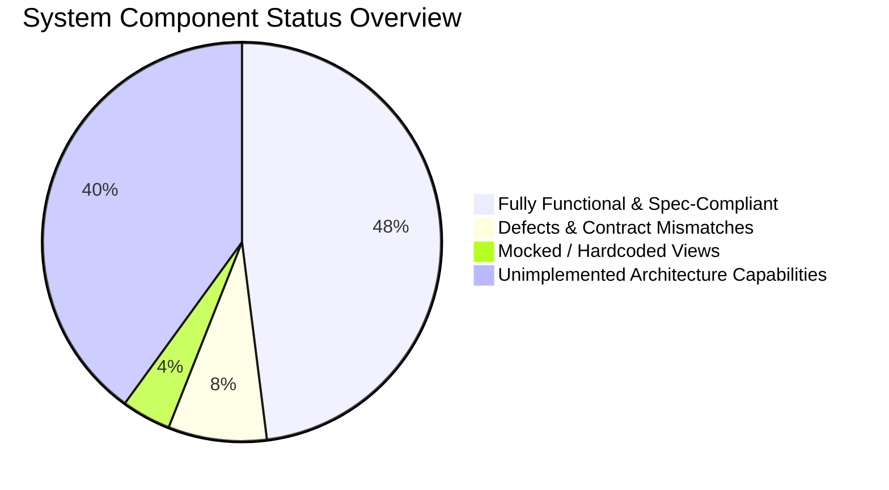
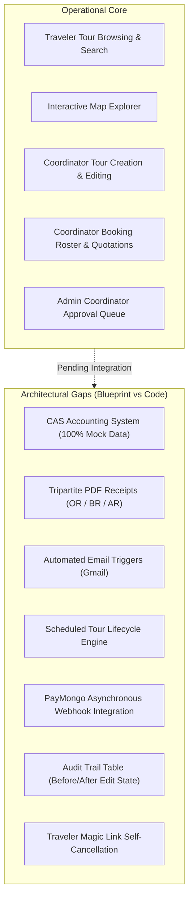
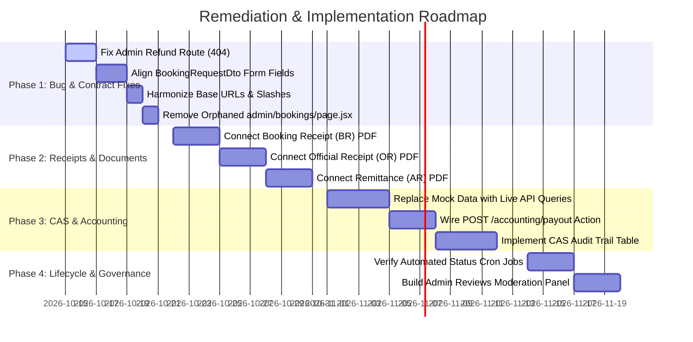

# TravelKo — Consolidated System Discovery & Audit Report

**Report Title:** End-to-End System Audit, API Specification Review & Architecture Blueprint Alignment  
**Audit Date:** October 2026  
**Audited Targets:**  
- **REST API Specification:** [`api/api.json`](file:///C:/Users/feljo/Desktop/TravelKo/api/api.json) (OpenAPI 3.0.0, 61 Operations, 54 Paths)  
- **Frontend Codebase:** [`travelko-next`](file:///C:/Users/feljo/Desktop/TravelKo/travelko-next) (Next.js 16 App Router, React 19, Tailwind v4)  
- **Production Reference:** [`travelko-production`](file:///C:/Users/feljo/Desktop/TravelKo/travelko-production)  
- **Official Blueprint:** 28-Page System Architecture & Computerized Accounting System (CAS) Flowchart  

---

## 1. Executive Summary

This consolidated report synthesizes the entire investigative audit performed across the TravelKo platform. By cross-referencing the **OpenAPI backend specification**, the **Next.js frontend implementation**, and the **28-page architectural design blueprint**, we established:

1. **API Implementation Coverage:** 34 of 61 specified endpoints (55.7%) are integrated into the frontend; 27 endpoints (44.3%) remain unconsumed or dormant.
2. **Critical Runtime Defects (404s):** 3 action buttons in the Admin Booking management view call non-existent API routes, causing runtime failures when administrators attempt to process refunds or update booking statuses.
3. **Data Contract Drift:** The public booking submission forms deviate from backend DTO requirements (`BookingRequestDto`), risking booking rejection or dropped data.
4. **Architectural Gaps:** While core routing, tour creation, and booking browsing are operational, major subsystem capabilities defined in the design diagrams — specifically the **Computerized Accounting System (CAS)**, **Tripartite PDF Receipt Generation**, **Automated Email Notifications**, **PayMongo Webhooks**, and **Scheduled Cron Lifecycle Transitions** — are either running on static mock data or absent from the client interface.

---

## 2. Comprehensive Discovery Scorecard

| Category | Audited Scope | Operational | Defective / Drift | Unimplemented / Mocked |
|---|---|---|---|---|
| **API Endpoints (`api.json`)** | 61 Operations | 31 (50.8%) | 3 (4.9%) | 27 (44.3%) |
| **Admin Booking Status Actions** | 4 Actions | 1 (25%) | 3 (75% - 404s) | 0 |
| **Booking DTO Contract** | 11 Fields | 7 (63.6%) | 4 (36.4%) | 0 |
| **CAS Accounting Subsystem** | 4 Reports & Tables | 0 (0%) | 0 | 4 (100% Mock Data) |
| **Electronic Receipts (PDFs)** | 5 Documents | 0 (0%) | 0 | 5 (100% Unconnected) |
| **Email & Notification Engine** | 5 Triggers | 0 (In-App) | 0 | 5 (External Only) |
| **Tour Lifecycle Automation** | 4 Status Transitions | 1 (Manual) | 0 | 3 (Scheduler Missing) |

---

## 3. High-Priority Defects & Data Contract Mismatches

### 🔴 Defect 1: Admin Booking Status Phantom Routes (Runtime 404 Errors)
* **Location:** [`src/app/(admin)/admin/booking-applications/page.jsx`](file:///C:/Users/feljo/Desktop/TravelKo/travelko-next/src/app/(admin)/admin/booking-applications/page.jsx#L122-L215)  
* **Impact:** Administrators cannot process client refunds, approve private bookings, or mark joiners as paid from the admin interface.

| UI Button / Action | Executed Code in Frontend | Result | Spec Route in `api.json` |
|---|---|---|---|
| **Process Client Refund** | `PATCH booking/update-status/${bookingId}` | ❌ **404 Not Found** (Missing leading slash & wrong path) | `PATCH /booking/update-status-to-refunded/{bookingId}` |
| **Mark Private Booking Paid/Approved** | `PUT /booking/private/update-status/${id}` | ❌ **404 Not Found** (Nonexistent endpoint) | `PUT /booking/private/approve/{bookingId}` or `PATCH /dev/bookings/{bookingId}/status` |
| **Mark Joiners Paid** | `PATCH /booking/joiner/update-status-to-paid/${tourId}` | ❌ **404 Not Found** (Nonexistent endpoint) | Paid status is intended to be set via PayMongo webhook or individual records. |

---

### 🔴 Defect 2: Public Booking Contract Drift (`BookingRequestDto`)
* **Locations:**  
  - [`src/app/(public)/book/page.jsx:175-188`](file:///C:/Users/feljo/Desktop/TravelKo/travelko-next/src/app/(public)/book/page.jsx#L175-L188)  
  - [`src/app/(public)/tours/book-private/page.jsx:110-123`](file:///C:/Users/feljo/Desktop/TravelKo/travelko-next/src/app/(public)/tours/book-private/page.jsx#L110-L123)  
* **Impact:** Booking submissions fail under strict NestJS ValidationPipes, or fail to capture essential refund credentials.

```mermaid
flowchart LR
    subgraph FrontendPayload ["Frontend Submitted Fields"]
        direction TB
        F1["bookingDateSelected ❌"]
        F2["amount ❌ (Extraneous)"]
        F3["Missing: accountName ⚠️"]
        F4["Missing: refundMethod ⚠️"]
        F5["Missing: accountNumber ⚠️"]
    end
    subgraph BackendContract ["api.json (BookingRequestDto)"]
        direction TB
        B1["tourDateSelected ✅ (Required)"]
        B2["(Server calculates pricing)"]
        B3["accountName ✅ (Required)"]
        B4["refundMethod ✅ (Required)"]
        B5["accountNumber ✅ (Required)"]
    end
    FrontendPayload ==>|Field Name Mismatch| BackendContract
```

---

### 🟡 Defect 3: Coordinator Registration Content-Type Divergence
* **Location:** [`src/app/(public)/coordinator/register-with-profile/page.jsx:404`](file:///C:/Users/feljo/Desktop/TravelKo/travelko-next/src/app/(public)/coordinator/register-with-profile/page.jsx#L404)  
* **Impact:** Multi-step registration submits `FormData` (multipart) containing `profilePicture` and `idPictures` to `POST /auth/coordinator`. However, `api.json` defines `POST /auth/coordinator` strictly as `application/json` consuming `CreateCoordinatorDto`. Image uploads sent here may be dropped unless processed by the dedicated profile update endpoint: `PUT /auth/coordinator`.

---

### 🟡 Defect 4: API Gateway Base URL Divergence
* **Location:** [`src/app/(public)/map/page.jsx:12`](file:///C:/Users/feljo/Desktop/TravelKo/travelko-next/src/app/(public)/map/page.jsx#L12)  
* **Finding:** While [`src/services/api.js`](file:///C:/Users/feljo/Desktop/TravelKo/travelko-next/src/services/api.js#L5) and public pages default to `https://api.travelko.site/`, `map/page.jsx` contains a hardcoded fallback to `https://api.travelkoph.com/`.

---

## 4. Architectural & Blueprint Gap Analysis

Comparison between the **28-Page System Flowchart** and the **Codebase Implementation**:

### 4.1. Computerized Accounting System (CAS) & Audit Trail
* **Blueprint Requirement (Pages 8, 15, 16):**
  - **Transaction Table:** Must record `BOOKING ID`, `OFFICIAL RECEIPT NO.`, `DATE`, `CUSTOMER NAME`, `TOUR ORGANIZER FEE`, `SERVICE FEE`, `PAYMENT GATEWAY FEE`, `TOTAL PAID`, `PAYMENT METHOD`, and `FILE ATTACHMENTS`.
  - **Formulaic Excel Export:** Filterable export generating automated column sums for fees and net totals.
  - **Audit Trail Table:** Real-time log capturing `UNIQUE ID`, `DATE/TIME`, `LINK TO TRANSACTION`, `ACTION (CREATE/UPDATE/DELETE)`, `USER`, `BEFORE EDIT` JSON state, and `AFTER EDIT` JSON state.
  - **Coordinator Payout Settlement:** Dispatched via `POST /accounting/payout`.
* **Current Reality:** [`src/app/(admin)/admin/accounting/page.jsx`](file:///C:/Users/feljo/Desktop/TravelKo/travelko-next/src/app/(admin)/admin/accounting/page.jsx) uses static mock arrays. No live API queries, Excel formula generators, or Audit Trail tables exist.

### 4.2. Tripartite Electronic Receipts (PDF Documents)
* **Blueprint Requirement (Pages 8, 9, 15, 16, 22):**
  1. **Booking Receipt (BR):** Sent to Booker & Organizer for full gross tour price (`POST /documents/pdf/booking-receipt`).
  2. **Official Receipt (OR):** BIR-compliant receipt sent to Booker for platform service fee only (`POST /documents/pdf/official-receipt`).
  3. **Acknowledgement Receipt (AR):** Remittance slip sent to Coordinator with net earnings, attaching all relevant BR receipts (`POST /documents/pdf/acknowledgement-receipt`).
* **Current Reality:** None of the 5 document generation endpoints in `api.json` are wired to any button or page in the frontend.

### 4.3. Automated Email Notification Engine
* **Blueprint Requirement (Pages 1, 2, 3, 4, 10, 11):**
  - Instant notifications dispatched on: private booking submission, coordinator quotation with payment gateway link, rejection with remarks, coordinator tour cancellation, and tour reschedule.
* **Current Reality:** The frontend triggers the REST status changes, but there is no in-app notification center or client-side confirmation of email dispatch status.

### 4.4. Tour Lifecycle Automation (Scheduler)
* **Blueprint Requirement (Pages 6, 12, 13):**
  $$\text{upcoming} \xrightarrow{\text{on start date (scheduled)}} \text{ongoing} \xrightarrow{\text{on end date (scheduled)}} \text{completed} \xrightarrow{\text{remitted (admin)}} \text{paid}$$
* **Current Reality:** Without an active backend cron runner, tours remain in `"upcoming"` status indefinitely unless manually altered via developer endpoints.

### 4.5. Legacy & Orphaned Files
* **Finding:** [`src/app/(admin)/admin/bookings/page.jsx`](file:///C:/Users/feljo/Desktop/TravelKo/travelko-next/src/app/(admin)/admin/bookings/page.jsx) contains static hardcoded bookings (`Mt. Apo Climb`, `Maria Santos`). It has been superseded by [`admin/booking-applications/page.jsx`](file:///C:/Users/feljo/Desktop/TravelKo/travelko-next/src/app/(admin)/admin/booking-applications/page.jsx) and is not linked in navigation.

---

## 5. Generated Documentation Artifacts

During this audit engagement, two comprehensive documents were compiled and placed into the repository:

1. **API Audit & Specification Documentation:**  
   [`travelko-next/docs/API_AUDIT_DOCUMENTATION.md`](file:///C:/Users/feljo/Desktop/TravelKo/travelko-next/docs/API_AUDIT_DOCUMENTATION.md)  
   * Complete inventory of all 61 OpenAPI endpoints.
   * Method, path, authorization, and implementation call sites.
   * Ready-to-apply remediation code snippets for fixing the 404 admin routes and payload contract mismatches.

2. **Customer/User Flow & Manual QA Testing Guide:**  
   [`travelko-next/docs/USER_FLOW_AND_MANUAL_TESTING_GUIDE.md`](file:///C:/Users/feljo/Desktop/TravelKo/travelko-next/docs/USER_FLOW_AND_MANUAL_TESTING_GUIDE.md)  
   * Step-by-step test cases for Traveler, Coordinator, and Admin workflows.
   * Full blueprint gap analysis detailing all missing features.
   * Feature traceability matrix and quick-run manual test checklist.

---

## 6. Strategic Remediation Roadmap

### Action Items for Immediate Next Steps:
1. **Apply Phase 1 Code Patches:** Fix the 3 broken endpoints in [`admin/booking-applications/page.jsx`](file:///C:/Users/feljo/Desktop/TravelKo/travelko-next/src/app/(admin)/admin/booking-applications/page.jsx) and the payload keys in [`book/page.jsx`](file:///C:/Users/feljo/Desktop/TravelKo/travelko-next/src/app/(public)/book/page.jsx).
2. **Execute Manual Smoke Testing:** Use the checklist in [`USER_FLOW_AND_MANUAL_TESTING_GUIDE.md`](file:///C:/Users/feljo/Desktop/TravelKo/travelko-next/docs/USER_FLOW_AND_MANUAL_TESTING_GUIDE.md#6-manual-qa-quick-run-checklist) to verify core features.
3. **Decide on CAS Integration Priorities:** Determine whether to prioritize connecting the PDF receipt endpoints (`POST /documents/pdf/*`) or replacing the accounting mock tables with live endpoints.
