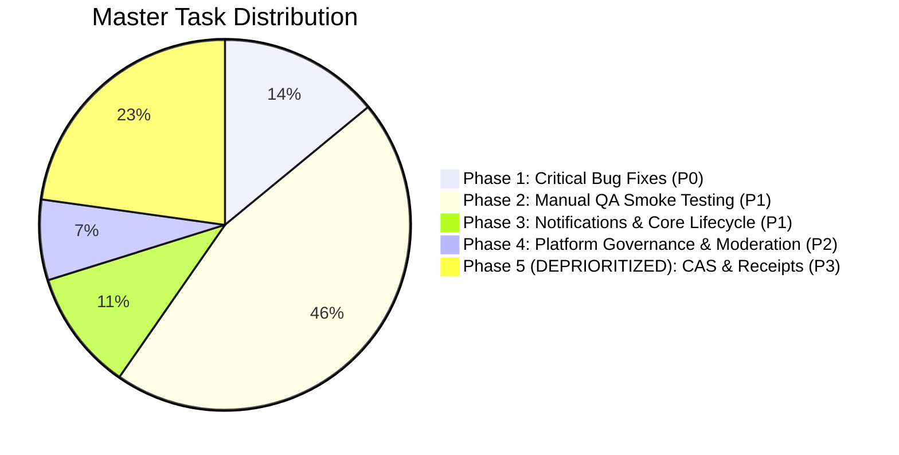

# TravelKo — Master TODO & Implementation Checklist

**Document Version:** 1.2.0  
**Target Application:** TravelKo Web Platform (`travelko-next`)  
**Backend API Spec:** OpenAPI 3.0 (`api/api.json`)  
**Architecture Policy:** Manual Admin KYC Review & Confirmation (Biometrics Removed)  
**Status:** Living Engineering Checklist (CAS Deprioritized, Biometrics Removed)  

---

## 📌 Re-Prioritized Status Dashboard

| Phase | Focus Area | Priority | Target Duration | Status |
|---|---|---|---|---|
| **Phase 1** | Immediate Defect & Contract Remediation | 🔴 **P0 (Critical)** | Days 1–3 | ⏳ Ready to Execute |
| **Phase 2** | Manual QA Smoke Testing (Core User Flows) | 🟡 **P1 (High)** | Days 4–6 | ⏸️ Blocked by P0 |
| **Phase 3** | Core Lifecycle, Notifications & Payment Webhooks | 🟡 **P1 (High)** | Days 7–11 | 📋 Next Up |
| **Phase 4** | Platform Governance & Review Moderation | 🔵 **P2 (Medium)** | Days 12–15 | 📋 Backlog |
| **Phase 5** | **Computerized Accounting (CAS) & PDF Receipts** | ⚪ **P3 (Deprioritized)** | Deferred | ⏸️ On Hold |

> [!NOTE]
> **Product Architecture Decision:** Automated Biometric / Face Scanning has been **permanently removed**. Coordinator account verification and onboarding follows a **100% Manual Confirmation & Approval** workflow conducted by platform administrators via [`/admin/applications`](file:///C:/Users/feljo/Desktop/TravelKo/travelko-next/src/app/(admin)/admin/applications/page.jsx).

---

## 🔴 Phase 1: Immediate Defect & Contract Remediation (P0)
*Goal: Eliminate runtime 404 errors, fix broken API routes, and align client payloads with backend DTOs.*

### 1.1. Admin Booking Status Bug Fixes
- [ ] **TASK-101: Fix Admin Client Refund Route (404)**
  - **File:** [`src/app/(admin)/admin/booking-applications/page.jsx:202`](file:///C:/Users/feljo/Desktop/TravelKo/travelko-next/src/app/(admin)/admin/booking-applications/page.jsx#L202)
  - **Problem:** Calls invalid relative path `booking/update-status/${bookingId}`.
  - **Fix:** Update to `PATCH /booking/update-status-to-refunded/${bookingId}` with `{ status: "refunded" }`.
- [ ] **TASK-102: Fix Admin Private Booking Status Route (404)**
  - **File:** [`src/app/(admin)/admin/booking-applications/page.jsx:125`](file:///C:/Users/feljo/Desktop/TravelKo/travelko-next/src/app/(admin)/admin/booking-applications/page.jsx#L125)
  - **Problem:** Calls nonexistent endpoint `PUT /booking/private/update-status/${id}`.
  - **Fix:** If approving, route to `PUT /booking/private/approve/${id}`; if updating status, use `PATCH /dev/bookings/${id}/status` or backend admin route.
- [ ] **TASK-103: Resolve Admin Bulk Joiner Update Route (404)**
  - **File:** [`src/app/(admin)/admin/booking-applications/page.jsx:152`](file:///C:/Users/feljo/Desktop/TravelKo/travelko-next/src/app/(admin)/admin/booking-applications/page.jsx#L152)
  - **Problem:** Calls nonexistent endpoint `PATCH /booking/joiner/update-status-to-paid/${tourId}`.
  - **Fix:** Remove button or integrate with PayMongo payment verification webhook.

### 1.2. Public Booking DTO Alignment (`BookingRequestDto`)
- [ ] **TASK-104: Fix Public Joiner Booking Payload**
  - **File:** [`src/app/(public)/book/page.jsx:175-188`](file:///C:/Users/feljo/Desktop/TravelKo/travelko-next/src/app/(public)/book/page.jsx#L175-L188)
  - **Fix 1:** Rename key `bookingDateSelected` ➔ `tourDateSelected`.
  - **Fix 2:** Add required refund destination inputs: `accountName`, `refundMethod`, `accountNumber`.
  - **Fix 3:** Omit redundant `amount` field (derived server-side).
- [ ] **TASK-105: Fix Private Booking Request Payload**
  - **File:** [`src/app/(public)/tours/book-private/page.jsx:110-123`](file:///C:/Users/feljo/Desktop/TravelKo/travelko-next/src/app/(public)/tours/book-private/page.jsx#L110-L123)
  - **Fix 1:** Rename key `bookingDateSelected` ➔ `tourDateSelected`.
  - **Fix 2:** Provide `accountName`, `refundMethod`, `accountNumber`.

### 1.3. Architecture & Cleanup
- [ ] **TASK-106: Harmonize Base API Gateway URL**
  - **File:** [`src/app/(public)/map/page.jsx:12`](file:///C:/Users/feljo/Desktop/TravelKo/travelko-next/src/app/(public)/map/page.jsx#L12)
  - **Problem:** Hardcoded fallback `https://api.travelkoph.com/`.
  - **Fix:** Change fallback to `https://api.travelko.site/` to match [`src/services/api.js`](file:///C:/Users/feljo/Desktop/TravelKo/travelko-next/src/services/api.js#L5).
- [ ] **TASK-107: Normalize Axios Request Leading Slashes**
  - **Files:** Across `src/app/` and `src/components/`
  - **Fix:** Prepend leading `/` to relative calls (`auth/coordinator/login`, `tours/my-tours`, `location/suggestions`).
- [ ] **TASK-108: Remove Orphaned Legacy Page**
  - **File:** [`src/app/(admin)/admin/bookings/page.jsx`](file:///C:/Users/feljo/Desktop/TravelKo/travelko-next/src/app/(admin)/admin/bookings/page.jsx)
  - **Fix:** Safely delete or archive this dead static mockup file.

---

## 🟡 Phase 2: Manual QA Smoke Testing & Core Flow Verification (P1)
*Goal: Step-by-step verification using [`USER_FLOW_AND_MANUAL_TESTING_GUIDE.md`](file:///C:/Users/feljo/Desktop/TravelKo/travelko-next/docs/USER_FLOW_AND_MANUAL_TESTING_GUIDE.md).*

### 2.1. Traveler / Customer Flows
- [ ] **QA-TRV-01:** Homepage hero banner, category filters, and featured tours rendering (`/`).
- [ ] **QA-TRV-02:** Interactive map tiles and tour pins explorer (`/map`).
- [ ] **QA-TRV-03:** Tour details, photo carousel, itinerary breakdown, and inclusions (`/tours/details/[id]`).
- [ ] **QA-TRV-04:** Submitting tour customer feedback and star ratings (`POST /reviews/{tourId}`).
- [ ] **QA-TRV-05:** Joiner booking submission and booking reference modal (`/book`).
- [ ] **QA-TRV-06:** Private tour custom request submission (`/tours/book-private`).
- [ ] **QA-TRV-07:** Static regulatory pages (`/about`, `/terms`, `/privacy`).

### 2.2. Coordinator Flows
- [ ] **QA-CRD-01:** Coordinator onboarding registration with ID document upload (`/coordinator/register-with-profile`).
- [ ] **QA-CRD-02:** Coordinator login and session persistence across page refreshes (`/login`).
- [ ] **QA-CRD-03:** Profile banking, GCash, and payout coordinates configuration (`/coordinator/profile`).
- [ ] **QA-CRD-04:** Coordinator dashboard KPI metrics (`/coordinator/dashboard`).
- [ ] **QA-CRD-05:** Tour creation with Mapbox autocomplete, itinerary, and photos (`/coordinator/tours`).
- [ ] **QA-CRD-06:** Tour package updating and deletion safeguards (`/coordinator/tours`).
- [ ] **QA-CRD-07:** Viewing booked joiners roster table (`/coordinator/bookings`).
- [ ] **QA-CRD-08:** Canceling joiner group tour and verifying slot counter reset (`/coordinator/bookings`).
- [ ] **QA-CRD-09:** Submitting private booking quotation with price and remarks (`/coordinator/bookings`).
- [ ] **QA-CRD-10:** Rejecting private booking request with mandatory remarks (`/coordinator/bookings`).
- [ ] **QA-CRD-11:** Canceling an upcoming approved private booking (`/coordinator/bookings`).

### 2.3. Administrator Flows (Including Manual KYC Review)
- [ ] **QA-ADM-01:** Admin login and system analytics dashboard (`/admin/dashboard`).
- [ ] **QA-ADM-02:** Reviewing coordinator applications with manual ID credential inspection (`/admin/applications`).
- [ ] **QA-ADM-03:** Manually approving coordinator account and verifying login capability (`/admin/applications`).
- [ ] **QA-ADM-04:** Manually declining coordinator account with notification (`/admin/applications`).
- [ ] **QA-ADM-05:** Inspecting approved coordinators directory and tour packages (`/admin/coordinators`).
- [ ] **QA-ADM-06:** Deleting coordinator profile and verifying tour unpublishing (`/admin/coordinator/[id]`).
- [ ] **QA-ADM-07:** Auditing Joiner & Private booking lists (`/admin/booking-applications`).
- [ ] **QA-ADM-08:** Processing client refund for cancelled bookings (`/admin/booking-applications`).

---

## 🟡 Phase 3: Core Lifecycle, Notifications & Payment Webhooks (P1)
*Goal: Implement transactional alerts, magic link cancellations, and lifecycle status progression.*

- [ ] **TASK-301: Traveler Magic Link Cancellation Route**
  - Create route: `src/app/(public)/cancel-booking/page.jsx` consuming `GET /booking/cancel-booking?token=...`.
- [ ] **TASK-302: Tour Reschedule Dual-Action Modal (Blueprint Page 4)**
  - Warn coordinator when editing Date/Location that an automated notification with cancellation link will be dispatched to joiners.
- [ ] **TASK-303: In-App Notification Center / Bell**
  - Add notification popover in [`AdminNav.jsx`](file:///C:/Users/feljo/Desktop/TravelKo/travelko-next/src/components/AdminNav.jsx) and [`CoordinatorNav.jsx`](file:///C:/Users/feljo/Desktop/TravelKo/travelko-next/src/components/CoordinatorNav.jsx).
- [ ] **TASK-304: Quotation & Rejection Email Confirmation Toasts**
  - Display confirmation feedback in coordinator bookings when quotes or rejections are dispatched.
- [ ] **TASK-305: Verify Scheduled Tour Lifecycle Daemon (Blueprint Pages 6, 12)**
  - Ensure background job transitions tours: `upcoming` ➔ `ongoing` ➔ `completed` ➔ `paid`.
- [ ] **TASK-306: PayMongo Payment Webhook Verification**
  - Confirm PayMongo `checkout_session.payment.paid` event successfully moves booking to `upcoming`/`paid`.

---

## 🔵 Phase 4: Platform Governance & Core Moderation (P2)
*Goal: Administrative moderation and customer directory management.*

- [ ] **TASK-401: Admin Reviews Moderation Panel**
  - Add "Reviews" tab in Admin portal.
  - Connect `GET /reviews`, `PATCH /reviews/{id}` (hide/edit), and `DELETE /reviews/{id}` (remove).
- [ ] **TASK-402: Customer / Booker Directory View**
  - Add "Bookers" tab in Admin navigation consuming `GET /bookers` and `GET /bookers/{id}`.
- [ ] **TASK-403: Dev Status Override Admin Toolbar**
  - Diagnostic panel hooking `PATCH /dev/tours/{tourId}/status` and `PATCH /dev/bookings/{bookingId}/status` for QA testing.
- [ ] **TASK-404: Coordinator Manual Status Filters in Admin**
  - Filter coordinators by `isApproved` status (Pending, Approved, Declined).

---

## ⚪ Phase 5 (DEPRIORITIZED): Computerized Accounting (CAS) & PDF Receipts (P3)
*Status: On Hold / Low Priority — To be implemented after core booking, tour management, and auth are hardened.*

- [ ] **TASK-501: Booking Receipt (BR) PDF Integration (`POST /documents/pdf/booking-receipt`)**
- [ ] **TASK-502: Official Receipt (OR) BIR-Compliant PDF Integration (`POST /documents/pdf/official-receipt`)**
- [ ] **TASK-503: Remittance Acknowledgement Receipt (AR) PDF Integration (`POST /documents/pdf/acknowledgement-receipt`)**
- [ ] **TASK-504: Refund Receipt (RR) PDF Integration (`POST /documents/pdf/refund-receipt`)**
- [ ] **TASK-505: PDF Download Utility Helper (`src/lib/downloadPdf.js`)**
- [ ] **TASK-506: Live Sales Report Query (Replace mock data in `admin/accounting`)**
- [ ] **TASK-507: Live Transaction History Table (Replace mock data in `admin/accounting`)**
- [ ] **TASK-508: Live Platform Revenue Report (Replace mock data in `admin/accounting`)**
- [ ] **TASK-509: Formulaic Excel Export Utility (Sum of fees, totals)**
- [ ] **TASK-510: CAS Audit Trail Table Implementation (`BEFORE EDIT` / `AFTER EDIT`)**
- [ ] **TASK-511: Wire Coordinator Payout Settlement Action (`POST /accounting/payout`)**
- [ ] **TASK-512: Attach Receipts to Coordinator Remittance Records**
- [ ] **TASK-513: Accounting Search & Date Range Filters**

---

## 📝 Test Run Sign-Off Sheet

| Phase | Assigned Lead | Date Started | Date Completed | QA Sign-Off | Status |
|---|---|---|---|---|---|
| **Phase 1: Bug Fixes (P0)** | __________________ | __________ | __________ | __________________ | ⏳ Pending |
| **Phase 2: QA Testing (P1)** | __________________ | __________ | __________ | __________________ | ⏳ Pending |
| **Phase 3: Lifecycle/Alerts (P1)** | __________________ | __________ | __________ | __________________ | ⏳ Pending |
| **Phase 4: Governance (P2)** | __________________ | __________ | __________ | __________________ | ⏳ Pending |
| **Phase 5: CAS/Receipts (P3)** | __________________ | __________ | __________ | __________________ | ⏸️ Deprioritized |
