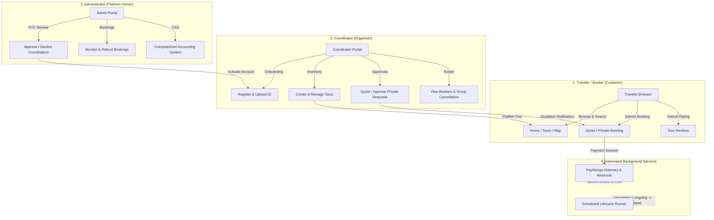
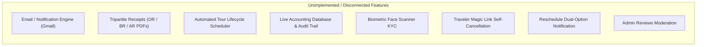
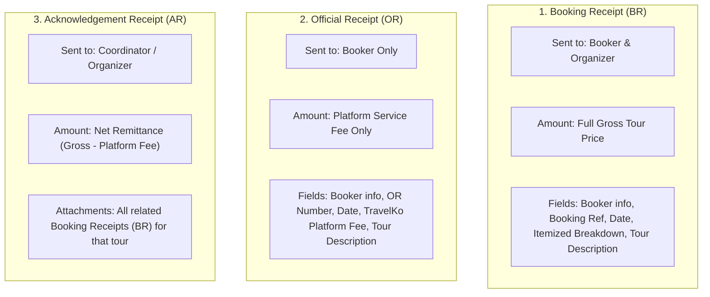

# TravelKo — Customer/User Flow & Manual QA Testing Guide

**Document Version:** 1.0.0  
**Target Application:** TravelKo Web Platform (`travelko-next`)  
**Backend API Spec:** OpenAPI 3.0 (`api/api.json`)  
**Architecture Source:** System Flowcharts & Computerized Accounting System (CAS) Blueprint  
**Audience:** QA Engineers, Manual Testers, Product Managers, Fullstack Developers  

---

## Table of Contents
1. [Executive Overview & System Architecture](#1-executive-overview--system-architecture)
2. [Actor Hierarchy & Role Matrix](#2-actor-hierarchy--role-matrix)
3. [PART 1: Existing Features — Step-by-Step Manual QA Testing Guide](#3-part-1-existing-features--step-by-step-manual-qa-testing-guide)
   - [3.1. Traveler / Customer Flow (Public)](#31-traveler--customer-flow-public)
   - [3.2. Coordinator Flow (Organizer)](#32-coordinator-flow-organizer)
   - [3.3. Administrator Flow (Governance)](#33-administrator-flow-governance)
4. [PART 2: Unimplemented Functions & Incomplete Flows (Architecture Gap Analysis)](#4-part-2-unimplemented-functions--incomplete-flows-architecture-gap-analysis)
   - [4.1. Automated Email & Notification Dispatch System](#41-automated-email--notification-dispatch-system)
   - [4.2. Tripartite Electronic Receipts Generation (CAS PDFs)](#42-tripartite-electronic-receipts-generation-cas-pdfs)
   - [4.3. Payment Gateway Webhook & Automated Reconciliation](#43-payment-gateway-webhook--automated-reconciliation)
   - [4.4. Automated Tour Lifecycle Scheduler (Cron Engine)](#44-automated-tour-lifecycle-scheduler-cron-engine)
   - [4.5. Live CAS Financial Reporting, Excel Formulas & Audit Trail](#45-live-cas-financial-reporting-excel-formulas--audit-trail)
   - [4.6. Face Scanner & Automated Biometric KYC Verification](#46-face-scanner--automated-biometric-kyc-verification)
   - [4.7. Traveler Magic Link Self-Cancellation Workflow](#47-traveler-magic-link-self-cancellation-workflow)
   - [4.8. Tour Reschedule Notification with Split Action Decision](#48-tour-reschedule-notification-with-split-action-decision)
   - [4.9. Review Moderation & Global Review Management](#49-review-moderation--global-review-management)
5. [Feature Traceability Matrix (Flowchart vs Codebase)](#5-feature-traceability-matrix-flowchart-vs-codebase)
6. [Manual QA Quick-Run Checklist](#6-manual-qa-quick-run-checklist)

---

## 1. Executive Overview & System Architecture

This guide establishes the official manual testing and verification procedures for the **TravelKo** travel aggregation and management platform. It synthesizes the actual Next.js 16 implementation ([`travelko-next`](file:///C:/Users/feljo/Desktop/TravelKo/travelko-next)), the OpenAPI 3.0 REST backend ([`api/api.json`](file:///C:/Users/feljo/Desktop/TravelKo/api/api.json)), and the official system architecture flowcharts.

The platform coordinates three human actors and two automated background engines:



---

## 2. Actor Hierarchy & Role Matrix

| Actor | Target Audience | Primary Access Points | Auth Required | Session Persistence |
|---|---|---|---|---|
| **Traveler (Customer)** | Tourists, joiners, private travel groups | `/`, `/tours`, `/map`, `/book`, `/tours/book-private` | ❌ No | Anonymous / Session |
| **Coordinator (Organizer)** | Local tour guides, registered agencies | `/coordinator/dashboard`, `/coordinator/tours`, `/coordinator/bookings`, `/coordinator/profile` | ✅ Yes (`coordinator` JWT) | `localStorage` / `sessionStorage` |
| **Administrator** | TravelKo operations, compliance & finance | `/admin/dashboard`, `/admin/applications`, `/admin/coordinators`, `/admin/booking-applications`, `/admin/accounting` | ✅ Yes (`admin` JWT) | `localStorage` / `sessionStorage` |
| **Payment Gateway** | PayMongo / Xendit webhook listener | `POST /payment/webhook` | 🔑 API Secret | Server-to-Server |
| **Cron Scheduler** | Scheduled background task runner | System daemon (`upcoming` ➔ `ongoing` ➔ `completed`) | 🔑 Internal / Service Key | Server Process |

---

## 3. PART 1: Existing Features — Step-by-Step Manual QA Testing Guide

Follow these sequential steps to manually verify every active, testable feature currently implemented in the codebase.

---

### 3.1. Traveler / Customer Flow (Public)

#### Test Case TRV-01: Public Homepage & Destination Discovery
* **Objective:** Verify landing page hero banners, promotional cards, and live tour previews.
* **Target Route:** [`http://localhost:3000/`](file:///C:/Users/feljo/Desktop/TravelKo/travelko-next/src/app/(public)/page.js)
* **Pre-conditions:** Backend server running at `https://api.travelko.site/` or local mock.
* **Step-by-Step Actions:**
  1. Open browser and navigate to `/`.
  2. Verify the hero section loads with title, video/image banner, and search bar.
  3. Verify the "Featured Tours" section renders cards fetched live from `GET /tours`.
  4. Click on any category badge (e.g., "Beach", "Mountain", "Island").
  5. Verify redirection to `/tours?category=...`.
* **Expected Result:** Landing page displays without layout shift; cards show thumbnail, tour title, price per joiner, and location.

---

#### Test Case TRV-02: Interactive Tours Map Explorer
* **Objective:** Verify Mapbox/Leaflet geospatial visualization of active tours.
* **Target Route:** [`http://localhost:3000/map`](file:///C:/Users/feljo/Desktop/TravelKo/travelko-next/src/app/(public)/map/page.jsx)
* **Step-by-Step Actions:**
  1. Click **"Map"** on the navigation bar.
  2. Confirm map tiles render centered on the Philippines.
  3. Verify map pins appear for tours possessing `latitude` and `longitude`.
  4. Click a map pin: verify popup displays tour title, price, thumbnail, and "View Tour" link.
  5. Click "View Tour" inside popup: verify navigation to `/tours/details/[id]`.
* **Expected Result:** Map renders pins accurately matching coordinates returned by `GET /tours`.

---

#### Test Case TRV-03: Tour Details Inspection & Review Submission
* **Objective:** Review complete itinerary, inclusions, coordinator info, and post customer feedback.
* **Target Route:** [`http://localhost:3000/tours/details/[id]`](file:///C:/Users/feljo/Desktop/TravelKo/travelko-next/src/app/(public)/tours/details/[id]/page.jsx)
* **Step-by-Step Actions:**
  1. Open a specific tour (e.g., `/tours/details/1`).
  2. Verify:
     - Photo carousel/gallery displays up to 10 uploaded images.
     - Details, itinerary breakdown, package inclusions, and things to bring render properly.
     - Available dates calendar highlights bookable dates.
  3. Scroll down to **"Customer Reviews & Ratings"**.
  4. In the "Leave a Review" form:
     - Enter Full Name (e.g., `Juan Dela Cruz`).
     - Select Star Rating (e.g., `5 Stars`).
     - Type Review Content (e.g., `Amazing experience! Super friendly coordinator.`).
     - Click **"Submit Review"**.
* **Expected Result:**
  - POST request sent to `POST /reviews/{tourId}`.
  - Toast notification appears: *"Review submitted successfully!"*.
  - New review appears immediately under the review list without full page refresh.

---

#### Test Case TRV-04: Joiner (Group) Tour Booking Submission
* **Objective:** Book slots in a shared group tour.
* **Target Route:** [`http://localhost:3000/book?tourId=[id]&type=joiner`](file:///C:/Users/feljo/Desktop/TravelKo/travelko-next/src/app/(public)/book/page.jsx)
* **Step-by-Step Actions:**
  1. On any tour details page, click **"Book as Joiner"**.
  2. Select an available tour date from the dropdown.
  3. Select number of individuals (e.g., `2`).
  4. Observe dynamic calculation of total price: `Joiner Price × Individuals`.
  5. Fill in Contact Details:
     - Full Name: `Maria Clara`
     - Email: `maria.clara@example.com`
     - Phone: `+639171234567` (or `09171234567`)
     - Special Requests: `Vegetarian meals preferred`
  6. Select Payment Method: `GCash` or `Bank Transfer`.
  7. Check "I agree to the Terms & Conditions".
  8. Click **"Confirm & Book"**.
* **Expected Result:**
  - API call made to `POST /booking/{tourId}`.
  - Success modal displays Booking Reference (`BK-...`).
  - If backend returns a PayMongo checkout URL, a new tab opens to the payment gateway.
> [!NOTE]
> **Known Bug Alert:** As identified in Defect-02 of our API Audit, the form currently sends `bookingDateSelected` instead of `tourDateSelected`. If your backend has strict validation enabled, apply the patch in [`docs/API_AUDIT_DOCUMENTATION.md`](file:///C:/Users/feljo/Desktop/TravelKo/travelko-next/docs/API_AUDIT_DOCUMENTATION.md#52-immediate-bug-fix-public-booking-contract-compliance).

---

#### Test Case TRV-05: Private Tour Booking Request Submission
* **Objective:** Request a custom exclusive tour without upfront pricing (price determined by coordinator).
* **Target Route:** [`http://localhost:3000/tours/book-private?tourId=[id]`](file:///C:/Users/feljo/Desktop/TravelKo/travelko-next/src/app/(public)/tours/book-private/page.jsx)
* **Step-by-Step Actions:**
  1. Navigate to `/tours/book-private?tourId=[id]`.
  2. Notice the price banner states: *"Price to be quoted by coordinator upon review"*.
  3. Select preferred custom date range.
  4. Input number of guests.
  5. Input Booker details (Full Name, Email, Philippine Mobile Number).
  6. Input custom notes/requests (e.g., *"Private van pickup at airport needed"*).
  7. Click **"Send Private Request"**.
* **Expected Result:**
  - API sends `POST /booking/{tourId}` with `bookingType: "private"`.
  - Toast confirmation: *"Private booking request sent! 🎉"*.
  - Redirects user back to `/tours`.
  - In backend, status is initialized as `"request"`.

---

#### Test Case TRV-06: Static & Regulatory Pages
* **Objective:** Validate legal, compliance, and corporate information.
* **Target Routes:**
  * [`/about`](file:///C:/Users/feljo/Desktop/TravelKo/travelko-next/src/app/(public)/about/page.jsx) — Mission, Vision, Company Overview, Legal Permits.
  * [`/terms`](file:///C:/Users/feljo/Desktop/TravelKo/travelko-next/src/app/(public)/terms/page.jsx) — Terms of Service, Cancellation Policy.
  * [`/privacy`](file:///C:/Users/feljo/Desktop/TravelKo/travelko-next/src/app/(public)/privacy/page.jsx) — Data Privacy Act Compliance.
* **Verification Check:** All sections render cleanly; links between terms and booking forms function properly.

---

### 3.2. Coordinator Flow (Organizer)

#### Test Case CRD-01: Coordinator Registration & KYC Verification
* **Objective:** Register a new tour coordinator account with identity documentation.
* **Target Route:**
  * Simple: [`/coordinator/register`](file:///C:/Users/feljo/Desktop/TravelKo/travelko-next/src/app/(public)/coordinator/register/page.jsx)
  * Multi-Step: [`/coordinator/register-with-profile`](file:///C:/Users/feljo/Desktop/TravelKo/travelko-next/src/app/(public)/coordinator/register-with-profile/page.jsx)
* **Step-by-Step Actions:**
  1. Navigate to `/coordinator/register-with-profile`.
  2. **Step 1 (Account Info):** Enter Full Name, Username, Email, Phone (`+639...`), Gender, and Password (min 8 chars, 1 uppercase, 1 special character).
  3. **Step 2 (Profile Photo):** Upload a clear square headshot (`.jpg`/`.png`).
  4. **Step 3 (ID Verification):** Select ID type (Passport / Driver's License / UMID / PhilID) and upload ID document photo.
  5. Click **"Submit Application"**.
* **Expected Result:**
  - Success modal confirms: *"Application submitted! Please wait for Admin approval."*
  - Redirects to `/login`.
  - Account is stored in backend with `isApproved: false`.

---

#### Test Case CRD-02: Coordinator Login & Session Persistence
* **Objective:** Authenticate coordinator and verify role-based route protection.
* **Target Route:** [`/login`](file:///C:/Users/feljo/Desktop/TravelKo/travelko-next/src/app/(public)/login/page.jsx)
* **Step-by-Step Actions:**
  1. On `/login`, toggle the role switch to **"Coordinator"**.
  2. Enter valid coordinator username & password.
  3. Check "Remember Me".
  4. Click **"Sign In"**.
* **Expected Result:**
  - POST request made to `POST /auth/coordinator/login`.
  - JWT token saved into `localStorage` (`auth_token`).
  - User redirected to `/coordinator/dashboard`.
  - Refresh the page: verify user remains logged in without re-authenticating.

---

#### Test Case CRD-03: Profile & Payout Bank Details Configuration
* **Objective:** Update payout banking coordinates for remittances.
* **Target Route:** [`/coordinator/profile`](file:///C:/Users/feljo/Desktop/TravelKo/travelko-next/src/app/(coordinator)/coordinator/profile/page.jsx)
* **Step-by-Step Actions:**
  1. Navigate to `/coordinator/profile`.
  2. Verify current info loaded via `GET /auth/coordinator`.
  3. Fill in Banking & Remittance fields:
     - Bank Name: `BDO Unibank`
     - Bank Account Name: `Juan Dela Cruz`
     - Bank Account Number: `1234567890`
     - GCash Number: `+639171234567`
     - Address: `Brgy. Poblacion, El Nido, Palawan`
  4. Click **"Save Changes"**.
* **Expected Result:**
  - Payload sent as `multipart/form-data` to `PUT /auth/coordinator`.
  - Toast confirmation: *"Profile updated successfully"*.

---

#### Test Case CRD-04: Coordinator Dashboard Analytics
* **Objective:** Verify coordinator KPI metrics.
* **Target Route:** [`/coordinator/dashboard`](file:///C:/Users/feljo/Desktop/TravelKo/travelko-next/src/app/(coordinator)/coordinator/dashboard/page.jsx)
* **Verification Check:**
  - Dashboard queries `GET /auth/coordinator/stats` and `GET /tours/my-tours`.
  - KPI cards reflect: Total Tours Published, Active Bookings, Total Gross Revenue (PHP), and Overall Rating average.

---

#### Test Case CRD-05: Tour Package Creation
* **Objective:** Create and publish a full multi-day or day-tour package.
* **Target Route:** [`/coordinator/tours`](file:///C:/Users/feljo/Desktop/TravelKo/travelko-next/src/app/(coordinator)/coordinator/tours/page.jsx)
* **Step-by-Step Actions:**
  1. Navigate to `/coordinator/tours`.
  2. Click **"+ Add Tour Package"** button.
  3. Fill out the creation form:
     - **Title:** `El Nido Island Hopping Tour A`
     - **Category:** `Island`
     - **Location / Address:** Type `El Nido` (Observe autocomplete suggestions from `GET /location/suggestions`).
     - **Coordinates:** Latitude `11.1949`, Longitude `119.4013`.
     - **Joiner Price:** `1500`
     - **Max Slots:** `20`
     - **Available Dates:** Pick multiple future calendar dates.
     - **Meetup Locations:** `El Nido Port, Corong-Corong Beach`
     - **Itinerary:** Add timeline items (e.g. `08:00 AM - Assembly`, `09:00 AM - Big Lagoon`, `12:00 PM - Buffet Lunch`).
     - **Inclusions:** `Lunch, Life vest, Mask & Snorkel, Environmental Fee`.
     - **Things to Bring:** `Sunscreen, Dry bag, Aqua shoes`.
     - **Photos:** Upload 3–5 tour photos.
  4. Click **"Publish Tour"**.
* **Expected Result:**
  - Multipart POST sent to `POST /tours/create`.
  - Tour immediately appears in coordinator's tour list and becomes visible publicly on `/tours` and `/map`.

---

#### Test Case CRD-06: Tour Editing & Deletion
* **Objective:** Edit tour details and verify deletion safeguards.
* **Target Route:** [`/coordinator/tours`](file:///C:/Users/feljo/Desktop/TravelKo/travelko-next/src/app/(coordinator)/coordinator/tours/page.jsx)
* **Step-by-Step Actions:**
  1. Click the **"Edit" (pencil)** icon on a tour card.
  2. Change price from `1500` to `1600`.
  3. Click **"Save Changes"**.
  4. Confirm update: calls `PUT /tours/update/{id}`.
  5. Click the **"Delete" (trash)** icon on a tour:
     - Confirm alert modal opens asking for verification.
     - Click "Confirm Delete".
* **Expected Result:** Tour deleted via `DELETE /tours/{id}` and removed from UI.

---

#### Test Case CRD-07: Joiner Bookings Roster & Bulk Tour Cancellation
* **Objective:** Inspect clients booked on a group tour and cancel if necessary.
* **Target Route:** [`/coordinator/bookings`](file:///C:/Users/feljo/Desktop/TravelKo/travelko-next/src/app/(coordinator)/coordinator/bookings/page.jsx)
* **Step-by-Step Actions:**
  1. Navigate to `/coordinator/bookings`.
  2. Select the **"Joiner Tours"** tab.
  3. Locate an upcoming tour with booked slots.
  4. Click **"View Clients"**:
     - Modal opens displaying the roster table (`Client Name`, `Contact Number`, `Email`, `Pax Count`, `Amount Paid`).
  5. Close modal and click **"Cancel Tour"**:
     - Modal warns: *"This will cancel all joiner bookings and initiate refunds."*
     - Click "Confirm Cancellation".
* **Expected Result:**
  - Calls `PATCH /booking/cancel/{tourId}/joiners`.
  - All joiner bookings for that tour are updated to status `"cancelled"`.
  - Booked slots counter resets to 0.

---

#### Test Case CRD-08: Private Booking Quotation & Approval Workflow
* **Objective:** Review a client's private booking request, submit a custom price quotation, and approve.
* **Target Route:** [`/coordinator/bookings`](file:///C:/Users/feljo/Desktop/TravelKo/travelko-next/src/app/(coordinator)/coordinator/bookings/page.jsx)
* **Step-by-Step Actions:**
  1. On `/coordinator/bookings`, click the **"Private Bookings"** or **"Pending Approval"** tab.
  2. Locate a request with status `"request"`.
  3. Click **"Approve / Send Quote"**:
     - Quotation modal appears.
     - Input **Quotation Price (PHP):** e.g. `8500`.
     - Input **Remarks:** e.g. `Includes private boat, seafood buffet, and van pickup.`
     - Click **"Confirm & Send Quotation"**.
* **Expected Result:**
  - Calls `PUT /booking/private/approve/{bookingId}` with `{ price: 8500, remarks: "..." }`.
  - Booking status changes to `"approved"`.
  - Quotation amount is displayed in the table.

---

#### Test Case CRD-09: Private Booking Rejection & Coordinator Cancellation
* **Objective:** Decline an infeasible private booking request or cancel an approved one.
* **Target Route:** [`/coordinator/bookings`](file:///C:/Users/feljo/Desktop/TravelKo/travelko-next/src/app/(coordinator)/coordinator/bookings/page.jsx)
* **Step-by-Step Actions:**
  1. On a `"request"` booking, click **"Reject"**.
  2. In rejection modal, enter remarks (minimum 10 characters, e.g. *"Unavailable on requested date due to sea weather advisories."*).
  3. Click **"Confirm Rejection"**.
* **Expected Result:**
  - Calls `PUT /booking/private/reject/{bookingId}` with `{ remarks: "..." }`.
  - Booking status transitions to `"rejected"`.
  - *(Optional)* For an upcoming `"approved"` private booking, clicking **"Cancel Booking"** calls `PUT /booking/cancel/{bookingId}/private` with cancellation remarks.

---

### 3.3. Administrator Flow (Governance)

#### Test Case ADM-01: Admin Login & Secure Dashboard
* **Objective:** Access administrative command center.
* **Target Route:** [`/login`](file:///C:/Users/feljo/Desktop/TravelKo/travelko-next/src/app/(public)/login/page.jsx) ➔ [`/admin/dashboard`](file:///C:/Users/feljo/Desktop/TravelKo/travelko-next/src/app/(admin)/admin/dashboard/page.jsx)
* **Step-by-Step Actions:**
  1. On `/login`, toggle role to **"Admin"**.
  2. Enter admin credentials and click "Sign In".
* **Expected Result:**
  - Calls `POST /auth/admin/login`.
  - Sets `auth_role: "admin"`.
  - Redirects to `/admin/dashboard`.
  - Queries `GET /auth/admin/dashboard` to display platform-wide metrics (total revenue, active coordinators, booking volumes).

---

#### Test Case ADM-02: Coordinator KYC Application Review (Approve / Decline)
* **Objective:** Review pending coordinator applications and verify credentials.
* **Target Route:** [`/admin/applications`](file:///C:/Users/feljo/Desktop/TravelKo/travelko-next/src/app/(admin)/admin/applications/page.jsx)
* **Step-by-Step Actions:**
  1. Navigate to `/admin/applications`.
  2. Table lists all coordinators fetched from `GET /auth/admin/for-approval-coordinators`.
  3. Click **"View ID"** to inspect uploaded government ID credentials.
  4. Test **Approve Action**: Click "Approve" button on applicant A.
     - Calls `PATCH /auth/admin/approve-coordinator/{id}`.
     - Status updates to Approved; coordinator can now login and publish tours.
  5. Test **Decline Action**: Click "Decline" button on applicant B.
     - Calls `GET /auth/admin/decline-coordinator/{id}`.
     - Applicant is removed from approval queue.

---

#### Test Case ADM-03: Approved Coordinators Directory & Audit
* **Objective:** Inspect approved coordinators and their published tour inventory.
* **Target Route:** [`/admin/coordinators`](file:///C:/Users/feljo/Desktop/TravelKo/travelko-next/src/app/(admin)/admin/coordinators/page.jsx) ➔ [`/admin/coordinator/[id]`](file:///C:/Users/feljo/Desktop/TravelKo/travelko-next/src/app/(admin)/admin/coordinator/[id]/page.jsx)
* **Step-by-Step Actions:**
  1. Navigate to `/admin/coordinators`.
  2. Table displays approved coordinators via `GET /auth/admin/approved-coordinators`.
  3. Click on a coordinator row or "View Profile":
     - Navigates to `/admin/coordinator/[id]`.
     - Queries `GET /auth/admin/tours-created-by-coordinator/{id}`.
     - Displays coordinator personal info, bank details, contact numbers, and list of all authored tours.
  4. Test Account Removal: Click "Delete Coordinator Profile" ➔ calls `DELETE /auth/admin/delete-coordinator/{id}`.

---

#### Test Case ADM-04: Admin Booking Applications & Refund Processing
* **Objective:** Audit traveler bookings and process client refunds for cancelled bookings.
* **Target Route:** [`/admin/booking-applications`](file:///C:/Users/feljo/Desktop/TravelKo/travelko-next/src/app/(admin)/admin/booking-applications/page.jsx)
* **Step-by-Step Actions:**
  1. Navigate to `/admin/booking-applications`.
  2. Toggle between **"Joiner Bookings"** (`GET /booking/joiner/find-all`) and **"Private Bookings"** (`GET /booking/private/find-all`).
  3. Select a cancelled booking.
  4. Click **"Process Refund"** button:
* **Expected Result:**
  - Marks booking as `"refunded"`.
> [!WARNING]
> **Known Bug Alert:** As identified in Defect-01, line 202 currently calls `booking/update-status/${bookingId}` (which returns 404). Apply the fix from [`docs/API_AUDIT_DOCUMENTATION.md`](file:///C:/Users/feljo/Desktop/TravelKo/travelko-next/docs/API_AUDIT_DOCUMENTATION.md#51-immediate-bug-fix-admin-booking-status-updates) to make this action call `PATCH /booking/update-status-to-refunded/{bookingId}`.

---

#### Test Case ADM-05: Computerized Accounting System (CAS) Interface
* **Objective:** Review the financial reporting UI.
* **Target Route:** [`/admin/accounting`](file:///C:/Users/feljo/Desktop/TravelKo/travelko-next/src/app/(admin)/admin/accounting/page.jsx)
* **Step-by-Step Actions:**
  1. Navigate to `/admin/accounting`.
  2. Switch between the 4 tabs:
     - **Sales Report:** Tour sales counts and gross revenues.
     - **Transaction History:** Transaction IDs, reference codes, payment methods.
     - **Revenue Report:** Service fee rates (10%), platform revenue collected, coordinator payout pool.
     - **Booking Summary:** Consolidated booking records.
  3. Click **"Export [TAB]"**: Toast triggers confirming CSV export simulation.

---

## 4. PART 2: Unimplemented Functions & Incomplete Flows (Architecture Gap Analysis)

The following capabilities are prominently specified in the official architecture flowcharts (Pages 1–28) and the OpenAPI backend specification (`api/api.json`), but are **not yet connected, functional, or built** in the frontend client.



---

### 4.1. Automated Email & Notification Dispatch System

#### Architecture Specification (Pages 1, 2, 3, 4, 10, 11)
The flowchart mandates automated transactional email notifications triggered at specific lifecycle events:
1. **Private Booking Request Submitted:** Email sent to Traveler: *"Notification that request was sent"*; Notification pushed to Coordinator Dashboard (Page 10).
2. **Private Booking Quotation Sent:** Email sent to Traveler containing tour details, approved quotation amount, and PayMongo payment gateway link (Pages 2, 10).
3. **Private Booking Declined:** Email sent to Traveler: *"Tour request was declined"* with coordinator's reason/remarks (Pages 1, 10, 11).
4. **Tour Reschedule by Coordinator:** Email sent to all joiners with notification and a magic cancellation link (Page 4).
5. **Tour Cancellation by Coordinator:** Email notification sent to all joiners / private bookers (Pages 1, 3, 4).

#### Current Implementation Status
* **Status:** 🔴 **Missing in Frontend**
* **Findings:** The frontend code performs the REST calls (`approve`, `reject`, `cancel`), but relies entirely on external backend mailers (e.g. Nodemailer / SendGrid / AWS SES) to send emails. There is no in-app notification center, bell icon, or notification inbox for either Traveler or Coordinator.
* **Required Implementation:**
  - Build an in-app notification bell component in [`CoordinatorNav.jsx`](file:///C:/Users/feljo/Desktop/TravelKo/travelko-next/src/components/CoordinatorNav.jsx) and [`AdminNav.jsx`](file:///C:/Users/feljo/Desktop/TravelKo/travelko-next/src/components/AdminNav.jsx).
  - Add toast feedback letting coordinators know: *"Quotation and payment link have been emailed to the client."*

---

### 4.2. Tripartite Electronic Receipts Generation (CAS PDFs)

#### Architecture Specification (Pages 8, 9, 15, 16, 22)
The Computerized Accounting System (CAS) defines three distinct official electronic receipts:



#### Corresponding Backend Endpoints (`api/api.json`):
* `POST /documents/pdf/booking-receipt`
* `POST /documents/pdf/official-receipt`
* `POST /documents/pdf/acknowledgement-receipt`
* `POST /documents/pdf/refund-receipt`
* `POST /documents/pdf/create`

#### Current Implementation Status
* **Status:** 🔴 **Unimplemented in Frontend**
* **Findings:** None of these 5 PDF generation endpoints are wired into any button or page in `travelko-next`. The "Export" buttons in [`admin/accounting/page.jsx`](file:///C:/Users/feljo/Desktop/TravelKo/travelko-next/src/app/(admin)/admin/accounting/page.jsx#L95) only trigger mockup toast notifications.
* **Required Implementation:**
  - On the booking confirmation screen and traveler email, provide a **"Download Booking Receipt (PDF)"** button calling `POST /documents/pdf/booking-receipt`.
  - In Admin Accounting, add **"Download Official Receipt"** and **"Download Remittance AR"** buttons streaming the generated PDF blob to the browser.

---

### 4.3. Payment Gateway Webhook & Automated Reconciliation

#### Architecture Specification (Pages 2, 6, 9, 10, 12)
* When a traveler books (Joiner) or pays an approved quotation (Private), they are redirected to a PayMongo checkout session.
* Upon successful payment, PayMongo fires an asynchronous webhook event:
  `checkout_session.payment.paid` with metadata `{ bookingId, tourId, bookerId }`.
* The webhook handler automatically transitions the booking status from `unpaid` / `request` ➔ **`upcoming`** / **`paid`**.
* The client receives a payment receipt directly from PayMongo (Page 9).

#### Current Implementation Status
* **Status:** 🟡 **Partially Implemented (Client Redirect Only)**
* **Findings:**
  - Client handles PayMongo URL redirects in [`book/page.jsx:192`](file:///C:/Users/feljo/Desktop/TravelKo/travelko-next/src/app/(public)/book/page.jsx#L192) (`window.open(res.data, "_blank")`).
  - However, there is no client-side payment verification / polling landing page (e.g. `/book/success?session_id=...`) to verify that the webhook actually updated the status before thanking the customer.
  - The direct payment endpoints in `api.json` (`POST /payment`, `GET /payment/{id}`, `POST /payment/cancel/{id}`) are not consumed.

---

### 4.4. Automated Tour Lifecycle Scheduler (Cron Engine)

#### Architecture Specification (Pages 6, 12, 13)
The flowchart dictates that status transitions over time must be automated:

$$\text{upcoming} \xrightarrow{\text{on tour start date}} \text{ongoing} \xrightarrow{\text{on tour end date}} \text{completed} \xrightarrow{\text{remitted by admin}} \text{paid}$$

* `upcoming` ➔ `ongoing`: **"updated by scheduled"** (Page 12)
* `ongoing` ➔ `completed`: **"updated by scheduled"** (Page 12)
* `completed` ➔ `paid`: **"updated by admin"** (after coordinator remittance is released) (Page 12)

#### Current Implementation Status
* **Status:** 🔴 **Missing UI Integration / Backend Cron Dependent**
* **Findings:**
  - The frontend relies on status strings returned by `GET /tours/all/statuses` and `GET /booking/all/statuses`.
  - If the backend cron job is not running, tours remain stuck in `"upcoming"` forever.
  - In `travelko-production`, developers introduced a client-side helper [`src/lib/tourStatus.js`](file:///C:/Users/feljo/Desktop/TravelKo/travelko-production/src/lib/tourStatus.js) to compute dynamic statuses on the fly, but it is not synced to `travelko-next` or the backend database.
  - Developer override endpoints exist (`PATCH /dev/tours/{tourId}/status` and `PATCH /dev/bookings/{bookingId}/status`), but there is no admin UI to trigger them.

---

### 4.5. Live CAS Financial Reporting, Excel Formulas & Audit Trail

#### Architecture Specification (Pages 8, 15, 16)
The Computerized Accounting System (CAS) blueprint mandates:
1. **Transaction Table Columns (Page 15):**
   `BOOKING ID` | `OFFICIAL RECEIPT NO.` | `DATE` | `CUSTOMER NAME` | `TOUR ORGANIZER FEE` | `SERVICE FEE` | `PAYMENT GATEWAY FEE` | `TOTAL PAID` | `PAYMENT METHOD` | `FILE ATTACHMENTS (RECEIPTS)`
2. **Formulaic Excel Export:**
   Export to Excel with filters (`Booking ID`, `OR No.`, `Date`). Below the table, it must output automatic spreadsheet sum formulas:
   $$\sum (\text{Tour Organizer Fee}), \quad \sum (\text{Service Fee}), \quad \sum (\text{Payment Gateway Fee}), \quad \sum (\text{Total Paid})$$
3. **Audit Trail Table (Pages 15–16):**
   `UNIQUE ID` | `DATE AND TIME` | `LINK TO TRANSACTION / TOUR` | `ACTION (CREATE/UPDATE/DELETE)` | `USER (Admin/System)` | `BEFORE EDIT` | `AFTER EDIT`
   * Example: Action `CREATE`, User `Admin`, Before Edit `NULL`, After Edit `{"customer":"Juan Dela Cruz", "amount":1000, "booking_id":"BK1234"}`.
4. **Coordinator Payout Remittance:**
   Hooked into `POST /accounting/payout` with `CreatePayoutDto` (`tourId`, `bookingIds`, `paymentMethod`, `referenceNo`, `paidAt`, `transactionFee`, `remarks`).

#### Current Implementation Status
* **Status:** 🔴 **100% Mock Data in Frontend**
* **Findings:**
  - [`src/app/(admin)/admin/accounting/page.jsx`](file:///C:/Users/feljo/Desktop/TravelKo/travelko-next/src/app/(admin)/admin/accounting/page.jsx) uses static JavaScript arrays (`MOCK_SALES_REPORT`, `MOCK_TRANSACTIONS`, `MOCK_REVENUE_REPORT`, `MOCK_BOOKING_SUMMARY`).
  - The Audit Trail Table and Excel Formula generator are completely absent from the page.
  - The backend payout endpoint `POST /accounting/payout` is never called.

---

### 4.6. Coordinator Onboarding: Manual Admin KYC Verification & Confirmation Policy

#### Product Policy & Architecture Update
* **Design Decision:** The automated biometric / face scanner requirement has been **officially removed** from the platform architecture.
* **Adopted Workflow:** Coordinator onboarding is governed by a **100% Manual Review & Confirmation** process conducted by platform administrators:
  1. **Application Submission:** The applicant fills out their personal profile, banking details, and uploads high-resolution images of their valid government ID credentials (Passport, Driver's License, UMID, PhilID) via [`/coordinator/register-with-profile`](file:///C:/Users/feljo/Desktop/TravelKo/travelko-next/src/app/(public)/coordinator/register-with-profile/page.jsx).
  2. **Pending Queue State:** The account is stored in the database with `isApproved: false` and queued under `GET /auth/admin/for-approval-coordinators`.
  3. **Manual Administrative Audit:** TravelKo administrators navigate to [`/admin/applications`](file:///C:/Users/feljo/Desktop/TravelKo/travelko-next/src/app/(admin)/admin/applications/page.jsx), inspect the submitted ID credentials, verify name/contact matching, and check for any compliance flags.
  4. **Approval / Decline Action:**
     - **Approval:** Admin clicks "Approve" ➔ calls `PATCH /auth/admin/approve-coordinator/{id}`. Account is activated immediately (`isApproved: true`). The coordinator receives permission to log in and publish tour packages.
     - **Decline:** Admin clicks "Decline" ➔ calls `GET /auth/admin/decline-coordinator/{id}`. The application is rejected.
* **Benefits:** Eliminates third-party biometric vendor dependencies, reduces onboarding friction, and guarantees human oversight against forged credentials.

---

### 4.7. Traveler Magic Link Self-Cancellation Workflow

#### Architecture Specification (Pages 1, 3, 4, 10)
* When a booking is confirmed, the traveler receives an email containing a secure cancellation link.
* Clicking the link directs the traveler to a cancellation confirmation route.

#### Corresponding Backend Endpoints (`api/api.json`):
* `GET /tours/generate_cancellation_link/{tourId}/{bookerId}`
* `GET /booking/cancel-booking?token=...`

#### Current Implementation Status
* **Status:** 🔴 **Unimplemented in Frontend**
* **Findings:**
  - There is no public route handler (e.g. `/cancel-booking?token=...`) in `travelko-next/src/app`.
  - Travelers cannot cancel their own bookings via self-service; they must contact the coordinator or admin manually.

---

### 4.8. Tour Reschedule Notification with Split Action Decision

#### Architecture Specification (Page 4)
When a coordinator edits a tour package, the flowchart branches based on what was modified:
* **Branch A (Place and Date Modified):** High-impact change. System must dispatch an email to all joiners with notification **plus a one-click magic cancellation link** allowing joiners who cannot attend the new date to cancel and receive a refund.
* **Branch B (Minor Details Modified - Itinerary, Things to Bring):** Low-impact change. Dispatches an informational notification only to joiners' emails without a cancellation link.

#### Current Implementation Status
* **Status:** 🔴 **Missing UI Distinction**
* **Findings:** In [`coordinator/tours/page.jsx:381`](file:///C:/Users/feljo/Desktop/TravelKo/travelko-next/src/app/(coordinator)/coordinator/tours/page.jsx#L381), editing a tour submits all fields indiscriminately via `PUT /tours/update/{id}`. There is no modal confirmation warning the coordinator that changing the date triggers cancellation links to existing bookers.

---

### 4.9. Review Moderation & Global Review Management

#### Architecture Specification (Page 9) & OpenAPI Spec
* Travelers submit reviews with rating, name, and comment (`POST /reviews/{tourId}`).
* Backend defines administrative moderation routes:
  - `GET /reviews` (List all reviews across all tours)
  - `GET /reviews/{id}`
  - `PATCH /reviews/{id}` (Edit/hide abusive content)
  - `DELETE /reviews/{id}` (Remove spam or fraudulent reviews)

#### Current Implementation Status
* **Status:** 🔴 **Unimplemented in Admin Portal**
* **Findings:**
  - While review submission on tour pages is functional ([`TourDetailsClient.jsx:84`](file:///C:/Users/feljo/Desktop/TravelKo/travelko-next/src/components/TourDetailsClient.jsx#L84)), there is no review moderation tab or page in the Admin navigation ([`AdminNav.jsx`](file:///C:/Users/feljo/Desktop/TravelKo/travelko-next/src/components/AdminNav.jsx)).
  - Admins cannot inspect, unpublish, or delete fraudulent reviews.

---

## 5. Feature Traceability Matrix (Flowchart vs Codebase)

This master matrix correlates every major functional node from the system flowcharts against the codebase implementation and assigns a manual QA verification status.

| Flowchart Section | Function / Process Box | UI Route in `travelko-next` | Backend API (`api.json`) | Implementation Status | QA Verdict |
|---|---|---|---|---|---|
| **Public / Traveler** | Homepage & Hero Banner | [`/`](file:///C:/Users/feljo/Desktop/TravelKo/travelko-next/src/app/(public)/page.js) | `GET /tours` | Implemented | ✅ PASS |
| **Public / Traveler** | Interactive Map Explorer | [`/map`](file:///C:/Users/feljo/Desktop/TravelKo/travelko-next/src/app/(public)/map/page.jsx) | `GET /tours` | Implemented | ⚠️ PASS (URL Divergence) |
| **Public / Traveler** | Tour Details & Itinerary | [`/tours/details/[id]`](file:///C:/Users/feljo/Desktop/TravelKo/travelko-next/src/app/(public)/tours/details/[id]/page.jsx) | `GET /tours/{id}` | Implemented | ✅ PASS |
| **Public / Traveler** | Customer Review Submission | [`TourDetailsClient.jsx`](file:///C:/Users/feljo/Desktop/TravelKo/travelko-next/src/components/TourDetailsClient.jsx) | `POST /reviews/{tourId}` | Implemented | ✅ PASS |
| **Public / Traveler** | Joiner Booking Form | [`/book`](file:///C:/Users/feljo/Desktop/TravelKo/travelko-next/src/app/(public)/book/page.jsx) | `POST /booking/{tourId}` | Contract Mismatch | ❌ DEFECT (Key Drift) |
| **Public / Traveler** | Private Booking Request | [`/tours/book-private`](file:///C:/Users/feljo/Desktop/TravelKo/travelko-next/src/app/(public)/tours/book-private/page.jsx) | `POST /booking/{tourId}` | Contract Mismatch | ❌ DEFECT (Key Drift) |
| **Public / Traveler** | Self-Cancellation via Magic Link | Missing Route | `GET /booking/cancel-booking` | Unimplemented | ⚪ NOT BUILT |
| **Public / Traveler** | Electronic Booking Receipt (BR) | Missing UI | `POST /documents/pdf/booking-receipt` | Unimplemented | ⚪ NOT BUILT |
| **Public / Traveler** | Electronic Official Receipt (OR) | Missing UI | `POST /documents/pdf/official-receipt` | Unimplemented | ⚪ NOT BUILT |
| **Coordinator** | Multi-Step KYC Registration | [`/coordinator/register-with-profile`](file:///C:/Users/feljo/Desktop/TravelKo/travelko-next/src/app/(public)/coordinator/register-with-profile/page.jsx) | `POST /auth/coordinator` | Content-Type Mismatch | ⚠️ WARN (FormData/JSON) |
| **Coordinator** | Manual Admin KYC Verification & Approval | [`/admin/applications`](file:///C:/Users/feljo/Desktop/TravelKo/travelko-next/src/app/(admin)/admin/applications/page.jsx) | `PATCH /auth/admin/approve-coordinator/{id}` | Implemented | ✅ PASS (Biometrics Removed) |
| **Coordinator** | Coordinator Login & Auth | [`/login`](file:///C:/Users/feljo/Desktop/TravelKo/travelko-next/src/app/(public)/login/page.jsx) | `POST /auth/coordinator/login` | Implemented | ✅ PASS |
| **Coordinator** | Banking Details & Profile | [`/coordinator/profile`](file:///C:/Users/feljo/Desktop/TravelKo/travelko-next/src/app/(coordinator)/coordinator/profile/page.jsx) | `PUT /auth/coordinator` | Implemented | ✅ PASS |
| **Coordinator** | Dashboard Metrics & KPIs | [`/coordinator/dashboard`](file:///C:/Users/feljo/Desktop/TravelKo/travelko-next/src/app/(coordinator)/coordinator/dashboard/page.jsx) | `GET /auth/coordinator/stats` | Implemented | ✅ PASS |
| **Coordinator** | Create Tour Package | [`/coordinator/tours`](file:///C:/Users/feljo/Desktop/TravelKo/travelko-next/src/app/(coordinator)/coordinator/tours/page.jsx) | `POST /tours/create` | Implemented | ✅ PASS |
| **Coordinator** | Location Suggestions Autocomplete | [`/coordinator/tours`](file:///C:/Users/feljo/Desktop/TravelKo/travelko-next/src/app/(coordinator)/coordinator/tours/page.jsx) | `GET /location/suggestions` | Implemented | ✅ PASS |
| **Coordinator** | Edit / Reschedule Tour | [`/coordinator/tours`](file:///C:/Users/feljo/Desktop/TravelKo/travelko-next/src/app/(coordinator)/coordinator/tours/page.jsx) | `PUT /tours/update/{id}` | Implemented | ✅ PASS |
| **Coordinator** | Delete Tour Package | [`/coordinator/tours`](file:///C:/Users/feljo/Desktop/TravelKo/travelko-next/src/app/(coordinator)/coordinator/tours/page.jsx) | `DELETE /tours/{id}` | Implemented | ✅ PASS |
| **Coordinator** | View Bookers Roster Table | [`/coordinator/bookings`](file:///C:/Users/feljo/Desktop/TravelKo/travelko-next/src/app/(coordinator)/coordinator/bookings/page.jsx) | `GET /booking/tours/joiners` | Implemented | ✅ PASS |
| **Coordinator** | Cancel Group Tour Bookings | [`/coordinator/bookings`](file:///C:/Users/feljo/Desktop/TravelKo/travelko-next/src/app/(coordinator)/coordinator/bookings/page.jsx) | `PATCH /booking/cancel/{tourId}/joiners` | Implemented | ✅ PASS |
| **Coordinator** | Approve Private Booking with Quote | [`/coordinator/bookings`](file:///C:/Users/feljo/Desktop/TravelKo/travelko-next/src/app/(coordinator)/coordinator/bookings/page.jsx) | `PUT /booking/private/approve/{bookingId}` | Implemented | ✅ PASS |
| **Coordinator** | Reject Private Booking with Remarks | [`/coordinator/bookings`](file:///C:/Users/feljo/Desktop/TravelKo/travelko-next/src/app/(coordinator)/coordinator/bookings/page.jsx) | `PUT /booking/private/reject/{bookingId}` | Implemented | ✅ PASS |
| **Coordinator** | Remittance Acknowledgement (AR) | None | `POST /documents/pdf/acknowledgement-receipt` | Unimplemented | ⚪ NOT BUILT |
| **Administrator** | Admin Login | [`/login`](file:///C:/Users/feljo/Desktop/TravelKo/travelko-next/src/app/(public)/login/page.jsx) | `POST /auth/admin/login` | Implemented | ✅ PASS |
| **Administrator** | Admin Analytics Dashboard | [`/admin/dashboard`](file:///C:/Users/feljo/Desktop/TravelKo/travelko-next/src/app/(admin)/admin/dashboard/page.jsx) | `GET /auth/admin/dashboard` | Implemented | ✅ PASS |
| **Administrator** | Review Coordinator Applications | [`/admin/applications`](file:///C:/Users/feljo/Desktop/TravelKo/travelko-next/src/app/(admin)/admin/applications/page.jsx) | `GET /auth/admin/for-approval-coordinators` | Implemented | ✅ PASS |
| **Administrator** | Approve Coordinator Account | [`/admin/applications`](file:///C:/Users/feljo/Desktop/TravelKo/travelko-next/src/app/(admin)/admin/applications/page.jsx) | `PATCH /auth/admin/approve-coordinator/{id}` | Implemented | ✅ PASS |
| **Administrator** | Decline Coordinator Account | [`/admin/applications`](file:///C:/Users/feljo/Desktop/TravelKo/travelko-next/src/app/(admin)/admin/applications/page.jsx) | `GET /auth/admin/decline-coordinator/{id}` | Implemented | ✅ PASS |
| **Administrator** | Coordinator Directory & Details | [`/admin/coordinator/[id]`](file:///C:/Users/feljo/Desktop/TravelKo/travelko-next/src/app/(admin)/admin/coordinator/[id]/page.jsx) | `GET /auth/admin/tours-created-by-coordinator/{id}` | Implemented | ✅ PASS |
| **Administrator** | Delete Coordinator Account | [`/admin/coordinator/[id]`](file:///C:/Users/feljo/Desktop/TravelKo/travelko-next/src/app/(admin)/admin/coordinator/[id]/page.jsx) | `DELETE /auth/admin/delete-coordinator/{id}` | Implemented | ✅ PASS |
| **Administrator** | Monitor Joiner & Private Bookings | [`/admin/booking-applications`](file:///C:/Users/feljo/Desktop/TravelKo/travelko-next/src/app/(admin)/admin/booking-applications/page.jsx) | `GET /booking/joiner/find-all`, `/private/find-all` | Implemented | ✅ PASS |
| **Administrator** | Update Status to Refunded | [`/admin/booking-applications`](file:///C:/Users/feljo/Desktop/TravelKo/travelko-next/src/app/(admin)/admin/booking-applications/page.jsx) | `PATCH /booking/update-status-to-refunded/{bookingId}` | Phantom Endpoint | ❌ DEFECT (404 Error) |
| **Administrator** | Admin Mark Paid / Approve Actions | [`/admin/booking-applications`](file:///C:/Users/feljo/Desktop/TravelKo/travelko-next/src/app/(admin)/admin/booking-applications/page.jsx) | Nonexistent in `api.json` | Phantom Endpoint | ❌ DEFECT (404 Error) |
| **Administrator** | CAS Financial Dashboard | [`/admin/accounting`](file:///C:/Users/feljo/Desktop/TravelKo/travelko-next/src/app/(admin)/admin/accounting/page.jsx) | Hardcoded Mock Data | Mocked Only | ⚠️ WARN (No Live Data) |
| **Administrator** | Excel Report with Sum Formulas | None | None | Unimplemented | ⚪ NOT BUILT |
| **Administrator** | CAS Audit Trail Table | None | None | Unimplemented | ⚪ NOT BUILT |
| **Administrator** | Coordinator Payout Settlement | None | `POST /accounting/payout` | Unimplemented | ⚪ NOT BUILT |
| **Administrator** | Review Content Moderation | None | `PATCH /reviews/{id}`, `DELETE /reviews/{id}` | Unimplemented | ⚪ NOT BUILT |

---

## 6. Manual QA Quick-Run Checklist

Copy and use this checklist during manual smoke testing and feature verification:

```markdown
### TravelKo Manual Smoke Test Checklist

#### 1. Public & Traveler Features
- [ ] TRV-01: Landing page renders hero, search, and featured tours
- [ ] TRV-02: Map Explorer renders interactive tour pins with popups
- [ ] TRV-03: Tour details page displays photo carousel, itinerary, and inclusions
- [ ] TRV-04: Submitting a customer review adds review under the tour
- [ ] TRV-05: Submitting Joiner booking form displays reference number modal
- [ ] TRV-06: Submitting Private booking request displays success toast
- [ ] TRV-07: Static About Us, Terms, and Privacy pages load with legal text

#### 2. Coordinator Features
- [ ] CRD-01: Coordinator registration submits application
- [ ] CRD-02: Coordinator login succeeds with valid credentials
- [ ] CRD-03: Refreshing coordinator dashboard maintains session
- [ ] CRD-04: Coordinator profile page loads and saves bank account info
- [ ] CRD-05: Dashboard metrics reflect active tour counts and statistics
- [ ] CRD-06: Publishing a new tour package adds card to tour list
- [ ] CRD-07: Location search provides real-time address suggestions
- [ ] CRD-08: Editing tour package updates title and price
- [ ] CRD-09: Viewing Joiner bookings displays booked clients roster table
- [ ] CRD-10: Canceling Joiner tour marks all joiners cancelled
- [ ] CRD-11: Approving private request with quote updates status to approved
- [ ] CRD-12: Rejecting private request with remarks updates status to rejected

#### 3. Administrator Features
- [ ] ADM-01: Admin login directs to admin dashboard
- [ ] ADM-02: Pending coordinator applications table loads applicant list
- [ ] ADM-03: Approving coordinator application enables account login
- [ ] ADM-04: Approved coordinators list displays active coordinators
- [ ] ADM-05: Coordinator profile shows all tours authored by coordinator
- [ ] ADM-06: Admin booking applications table shows Joiner & Private records
- [ ] ADM-07: Accounting page displays sales, transactions, revenue, and summary tabs

#### 4. Architecture Gaps & Known Defects to Note
- [ ] Admin "Process Refund" button fails with 404 (needs route patch)
- [ ] Public booking payload uses `bookingDateSelected` instead of `tourDateSelected`
- [ ] Accounting exports are simulated toasts (no live PDF/Excel formulas)
- [ ] No traveler email cancellation magic link handler currently exists
```
